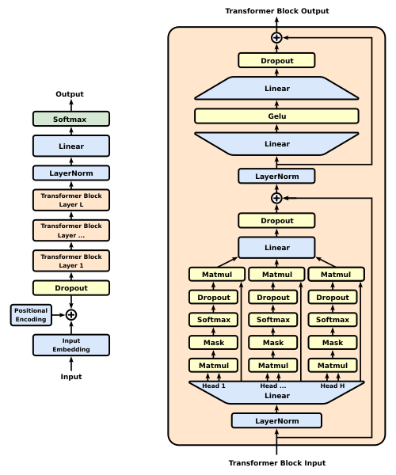
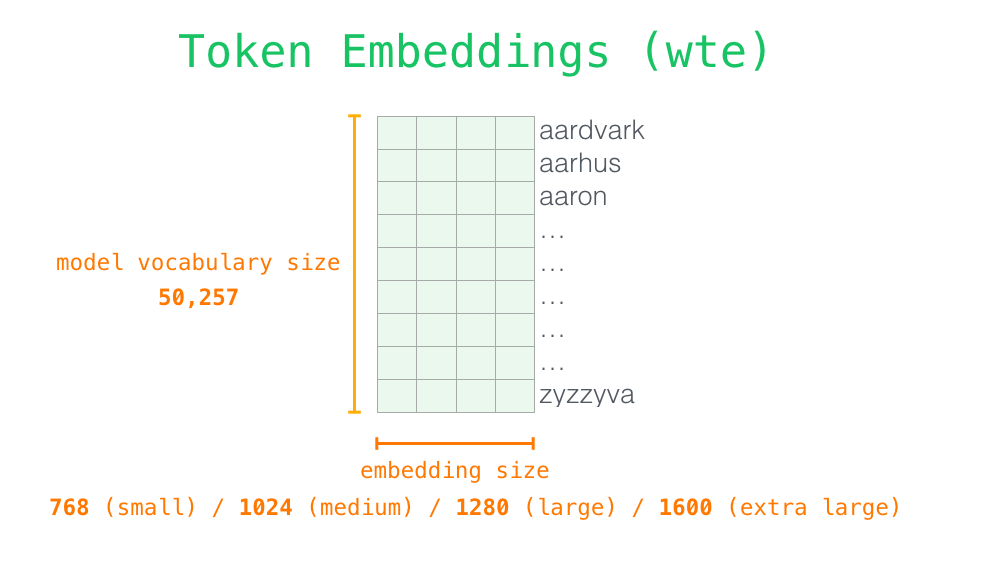
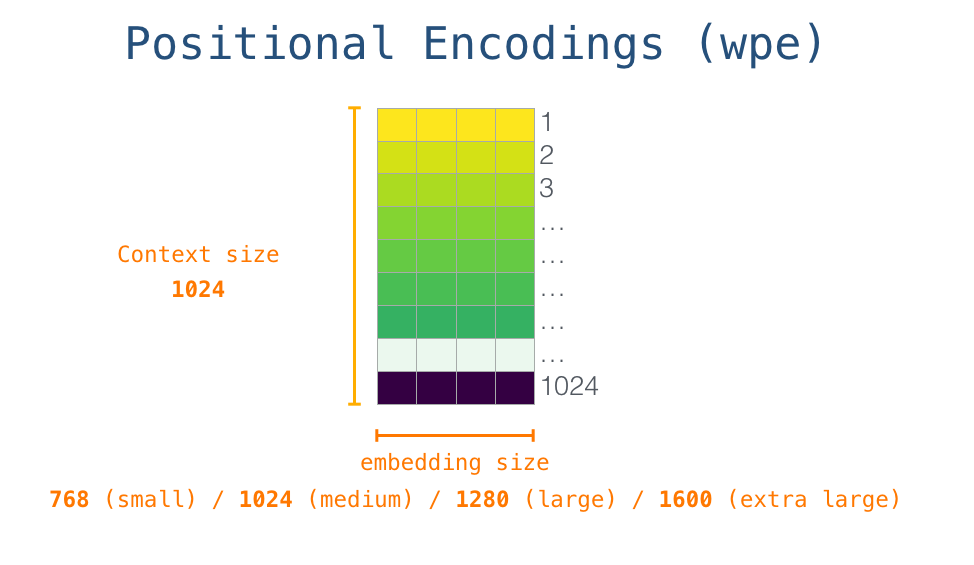
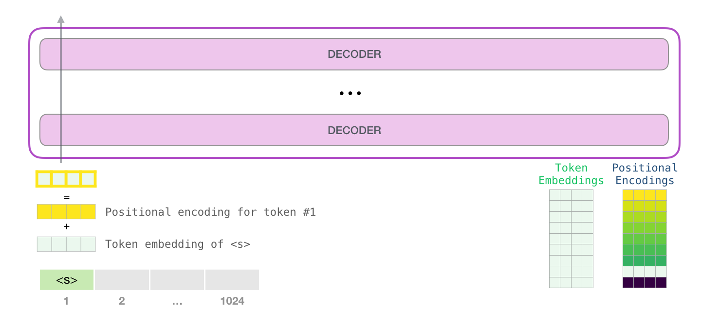
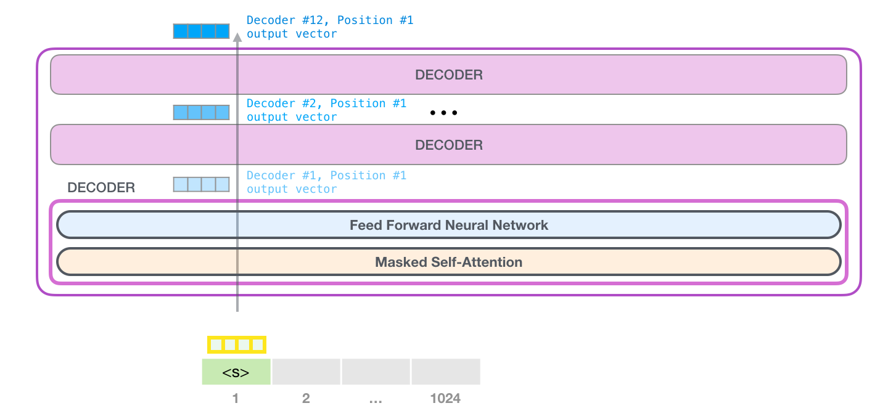
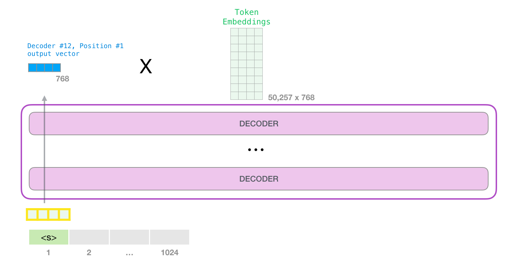
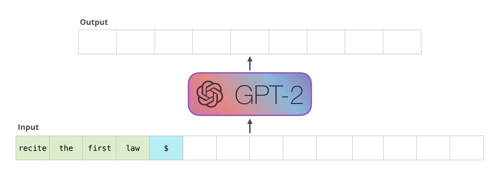

# Journey of a token

An LLM is a **next-token prediction engine**: text goes in, and it returns a probability for every token that could come next. This page opens that engine and follows one token through every stage, from raw text to the predicted next token.

- **Running example:** the prompt `A true friend accepts you`, followed from the point of view of the token `friend`.
- **Reference model:** GPT-2 small. It is small enough to hold in your head, and every modern LLM is a variation on it.
- Every number on this page (token IDs, shapes, probabilities, parameter counts) comes from running the real GPT-2 small weights.

## The big picture

The architecture has three parts:

| Part | Job | Steps |
|---|---|---|
| **1. Input** | turn text into vectors | tokenize, token embedding, positional embedding, add |
| **2. Processor** | mix in context, refine meaning | a stack of identical **transformer blocks** |
| **3. Output** | turn a vector back into a token | final layer norm, output projection, softmax, pick |



*Image: [Wikimedia Commons, Full GPT architecture](https://commons.wikimedia.org/wiki/File:Full_GPT_architecture.svg) (CC0). Read it bottom to top. Left is the whole model, right is one transformer block.*

The whole trip in shapes, for our 5-token prompt:

```text
"A true friend accepts you"                  text
        │  tokenizer
        ▼
[32, 2081, 1545, 18178, 345]                 5 token IDs
        │  token embedding + positional embedding
        ▼
X (5 × 768)                                  one vector per token
        │  transformer block × 12
        ▼
H (5 × 768)                                  same shape, new values
        │  final layer norm
        │  output projection
        ▼
logits (5 × 50257)                           one score per (position, vocabulary token)
        │  softmax on the last row, pick one
        ▼
" as"                                        the next token
```

The key fact to hold on to: **from the embedding step until the output projection, every token is a vector of 768 numbers, and that size never changes.** The blocks only change the values.

### The story version

The source lecture tells this as a story. The mapping is a handy memory aid:

| Story | What it really is |
|---|---|
| Token is isolated from its neighbours | tokenization |
| Token gets a badge (roll number) | token ID |
| Entrance exam with 768 questions about meaning | token embedding |
| Second exam with 768 questions about position | positional embedding |
| The two result sheets are merged into a uniform | input embedding (the sum) |
| Tokens board a train with 6 compartments | one transformer block |
| The train has 12 coaches | 12 stacked blocks |
| Uniform is swapped for a 50,257-entry score sheet | output projection (logits) |

### Reference numbers: GPT-2 small

| Symbol | Meaning | Value |
|---|---|---|
| `V` | vocabulary size | 50,257 |
| `d` | embedding dimension (width of every token vector) | 768 |
| `n_ctx` | context length (max tokens in one pass) | 1,024 |
| `L` | number of transformer blocks | 12 |
| `h` | attention heads per block | 12 |
| | total parameters | 124,439,808 (~124M) |

## Part 1: Input

Neural networks only do arithmetic on numbers. The input part turns text into one vector per token.

### Step 1: Tokenization

The text is cut into **tokens**, and each token is replaced by an integer, its **token ID**.

```text
"A true friend accepts you"

token      "A"   " true"   " friend"   " accepts"   " you"
token ID    32    2081      1545        18178        345
position    0     1         2           3            4
```

The ID comes from a fixed lookup table called the **vocabulary**: GPT-2's has 50,257 entries. A token is not always a word. The vocabulary holds:

- single characters and bytes (`a`, `!`)
- sub-words (`ization`)
- whole common words (` friend`)

Things to know:

- **The space belongs to the token.** `" friend"` (ID 1545) and `"friend"` (ID 6726) are different tokens.
- **Rare words are split.** `tokenization` becomes `token` + `ization`.
- **No word is ever "unknown".** Any text can be broken down to bytes, and every byte is in the vocabulary.
- **The ID carries no meaning.** 1545 is just a row number. IDs 1545 and 1546 are not related.
- **The vocabulary is model-specific.** The same text gives different IDs on a different model.

The vocabulary is built before training with **byte-pair encoding (BPE)**: start from single bytes, then repeatedly merge the most frequent adjacent pair into a new token until the vocabulary reaches the target size. Frequent words end up as one token, and rare words as a few pieces.

The tokenizer is a separate, fixed program that runs on the CPU. It has no trained weights inside the network.

### Step 2: Token embedding

Each ID is swapped for a vector of `d = 768` numbers that represents the token's **meaning**.

It is a pure table lookup. The model owns a matrix `W_te` of shape `V × d` (`50257 × 768`), and token ID `i` simply selects row `i`:

```text
" friend" → ID 1545 → W_te[1545] = [-0.0760, -0.1463, 0.1116, 0.0676, ...]     768 numbers
```



*Image: [Jay Alammar, The Illustrated GPT-2](https://jalammar.github.io/illustrated-gpt2/) (CC BY-NC-SA 4.0).*

**Intuition:** think of the 768 numbers as answers to 768 questions about the token. Is it a noun? Is it about people? Is it an emotion? In reality:

- nobody writes the questions, and a single dimension rarely has a clean human meaning
- the values start random and are learned during training
- the result still behaves like meaning: tokens used in similar contexts end up with similar vectors

This is the first place where meaning enters. The ID had none.

`d` is the model's width, and it differs per model:

| Model | `d` | Blocks | Heads | Parameters |
|---|---|---|---|---|
| GPT-2 small | 768 | 12 | 12 | 124M |
| GPT-2 medium | 1,024 | 24 | 16 | 355M |
| GPT-2 large | 1,280 | 36 | 20 | 774M |
| GPT-2 XL | 1,600 | 48 | 25 | 1.5B |
| GPT-3 (davinci) | 12,288 | 96 | 96 | 175B |

### Step 3: Positional embedding

The token embedding is the same wherever the token appears. That is a problem:

```text
The dog chased another dog
     ▲                  ▲
     same token, same embedding, but two different dogs
```

Attention (in Part 2) treats its input as an unordered set, so without extra information `dog bites man` and `man bites dog` would look identical. The model needs to know **where** each token sits.

GPT-2 fixes this with a second learned table `W_pe` of shape `n_ctx × d` (`1024 × 768`): one row per position.

```text
" friend" is at position 2 → W_pe[2] = [0.0042, -0.0848, 0.0545, -0.0047, ...]     768 numbers
```



*Image: [Jay Alammar, The Illustrated GPT-2](https://jalammar.github.io/illustrated-gpt2/) (CC BY-NC-SA 4.0). The image counts positions from 1, code counts from 0.*

- It has the same width `d` as the token embedding, so the two can be added.
- The row depends only on the position, never on which token is there.
- The table has 1,024 rows, which is exactly why GPT-2 cannot read more than 1,024 tokens at once. This is the **context length**.

### Step 4: Input embedding

Add the two vectors, element by element:

```text
input embedding = token embedding + positional embedding

W_te[1545]   [-0.0760, -0.1463,  0.1116,  0.0676, ...]     what " friend" means
W_pe[2]    + [ 0.0042, -0.0848,  0.0545, -0.0047, ...]     what "position 2" means
           = [-0.0718, -0.2310,  0.1661,  0.0629, ...]     " friend" at position 2
```



*Image: [Jay Alammar, The Illustrated GPT-2](https://jalammar.github.io/illustrated-gpt2/) (CC BY-NC-SA 4.0).*

This one 768-number vector is the token's "uniform". It now encodes both what the token is and where it is, and it is all the rest of the model ever sees. The transformer blocks never see text or IDs.

Do this for all 5 tokens and stack the rows: the input part hands the processor a matrix `X` of shape `5 × 768`.

One thing is still missing. Each row knows about its own token only. `friend` does not yet know that `true` sits next to it. Fixing that is the processor's job.

## Part 2: The processor

The processor is a stack of identical **transformer blocks**. Each block takes a `tokens × d` matrix and returns a `tokens × d` matrix.

One block has six steps, split into two sub-layers:

```text
x  (5 × 768)
│
├──────────────────────────┐
│  1. LayerNorm            │
│  2. Multi-head attention │  skip connection
│  3. Dropout              │
▼                          │
+ ◄────────────────────────┘
│
├──────────────────────────┐
│  4. LayerNorm            │
│  5. Feed-forward network │  skip connection
│  6. Dropout              │
▼                          │
+ ◄────────────────────────┘
│
▼
x  (5 × 768)
```

In code, the whole block is two lines:

```text
x = x + dropout(attention(layer_norm_1(x)))      tokens talk to each other
x = x + dropout(ffn(layer_norm_2(x)))            each token thinks on its own
```

The two sub-layers do very different jobs:

| | Attention | Feed-forward network |
|---|---|---|
| Looks at | other tokens | one token at a time |
| Job | **communication**: gather context | **computation**: process what was gathered |
| Share of block parameters | ~1/3 | ~2/3 |

### Layer normalization

Deep stacks are hard to train when the numbers flowing through them drift to very large or very small scales. Layer norm resets the scale before each sub-layer.

For each token's vector, on its own:

1. Subtract the vector's mean, so the mean becomes 0.
2. Divide by its standard deviation, so the standard deviation becomes 1.
3. Multiply by a learned **scale** `γ` and add a learned **shift** `β` (each has `d` values), so the model can undo the normalization where that helps.

```text
layer_norm(x) = γ × (x − mean(x)) / std(x) + β
```

GPT-2 applies it **before** each sub-layer ("pre-norm"), as in the diagram above. The original 2017 Transformer applied it after. Pre-norm trains more stably in deep stacks and is the standard today.

### Multi-head attention

This is the only place in the whole model where tokens exchange information.

For each token, attention answers: **how much should I care about each of the other tokens?** It then pulls in information from them in those proportions.

```text
I am from Pune, India. I speak ___
          ▲      ▲
          to predict the next word, these matter most
```

For `friend`, attention computes a weight for every visible token and replaces `friend`'s vector with a weighted mix of information from them. After this step, the vector no longer means "friend" in general. It means "friend, the one described as true, in this sentence".

Two details matter for the rest of this page:

- **Multi-head.** GPT-2 small runs 12 attention heads in parallel, each with `768 / 12 = 64` dimensions. Each head can track a different kind of relationship (the adjective of a noun, the subject of a verb, and so on). Their outputs are concatenated back to 768 and passed through a linear layer.
- **Causal mask.** A token may only attend to itself and the tokens **before** it. `friend` sees `A`, `true`, `friend`. It never sees `accepts` or `you`. This is what makes the model a left-to-right predictor, and it is why [training](#training) can use every position at once.

Attention is where DeepSeek's **multi-head latent attention (MLA)** changes the architecture. Self-attention, multi-head attention, and the KV cache each get their own page.

### Dropout

During training, dropout sets a random fraction of values to zero (10% in GPT-2).

- It stops the network from leaning on a few values, so every part has to learn something useful.
- That reduces overfitting and improves generalization.
- It is **switched off at inference**, so it does nothing when you use the model.

GPT-2 uses dropout in three places: on the input embedding, and after each of the two sub-layers. Most modern LLMs drop it entirely, since their training data is too large to overfit.

### Skip connections

The `+` in the block diagram: the input of a sub-layer is added back to its output.

```text
x = x + sublayer(x)
```

Why it matters:

- **Gradients survive.** Training sends gradients backwards through every layer. In a plain chain they are multiplied layer after layer and can shrink to zero (**vanishing gradients**, learning stops) or blow up (**exploding gradients**, learning is unstable). The `+` gives the gradient a direct path that skips the sub-layer.
- **Layers only learn a correction.** A sub-layer does not rebuild the token's vector. It only computes what to add to it.

This leads to a useful mental model, the **residual stream**: each token's 768-number vector is a running total that flows straight through the model. Every attention layer and every FFN reads from it and adds a small update to it. Nothing ever overwrites it.

### Feed-forward network

After attention has gathered context, the FFN processes each token **independently**. The same small network is applied to every row, and no information moves between tokens.

```text
768  ──►  Linear  ──►  3072  ──►  GELU  ──►  Linear  ──►  768
          expand ×4               non-linearity         compress
```

- **Expand:** project the vector to `4 × 768 = 3072` dimensions.
- **GELU:** a smooth non-linearity. Without it, the two linear layers would collapse into a single linear layer.
- **Compress:** project back to 768.

The wider middle gives the model a richer space to work in before it squeezes the result back to the standard width. The FFN holds about two thirds of each block's parameters, and it is believed to be where most of the model's factual knowledge is stored.

Because the FFN is the largest component, it is where DeepSeek applies **[mixture of experts (MoE)](../01_llm_inference/moe/intro.md)**: the single FFN is replaced by many expert FFNs, and each token uses only a few of them.

### Stacking the blocks

One block is not enough. GPT-2 small stacks 12 of them, and the output of one is the input of the next.



*Image: [Jay Alammar, The Illustrated GPT-2](https://jalammar.github.io/illustrated-gpt2/) (CC BY-NC-SA 4.0). "Decoder" here means one transformer block.*

- Every block has the **same structure** but its **own weights**.
- The shape stays `5 × 768` all the way up. Only the values change.
- Roughly, early blocks pick up surface patterns and grammar, and later blocks build more abstract meaning.

By the top of the stack, the vector at `friend`'s position is no longer a description of the word `friend`. It has been rewritten, 12 times over, into a description of **what should come after `A true friend`**.

## Part 3: Output

The processor leaves us with `H`, a `5 × 768` matrix. The output part turns each row into a prediction over the vocabulary.

### Final layer norm

One last layer norm, the same operation as inside the blocks. Because the blocks are pre-norm, the stream coming out of the last block has not been normalized, so this cleans it up. The shape stays `5 × 768`.

### Output projection

We need a score for each of the 50,257 tokens in the vocabulary, but we have 768 numbers. A single linear layer of shape `768 × 50257` does the conversion:

```text
logits = H · W_out        (5 × 768) · (768 × 50257) = (5 × 50257)
```

- Row `t` is the model's prediction for the token **after** position `t`.
- `logits[t, i]` is the raw score for vocabulary token `i`. These raw scores are called **logits**. They can be any real number and are not probabilities yet.



*Image: [Jay Alammar, The Illustrated GPT-2](https://jalammar.github.io/illustrated-gpt2/) (CC BY-NC-SA 4.0).*

**Weight tying.** As the image shows, GPT-2 does not learn a separate `W_out`. It reuses the token embedding matrix `W_te` from Step 2, transposed. So `logits[t, i]` is the dot product between the final vector and token `i`'s embedding: the model scores each token by **how similar the final vector is to that token's embedding**. This also saves 38.6M parameters.

### From logits to the next token

At inference, only the **last row** matters, because it predicts what follows the whole prompt.

**1. Softmax** turns that row of 50,257 logits into probabilities that sum to 1:

```text
softmax(x)_i = exp(x_i) / Σ_j exp(x_j)
```

For `A true friend accepts you`, GPT-2 small gives:

| Token | ID | Logit | Probability |
|---|---|---|---|
| ` as` | 355 | −99.29 | 13.5% |
| `.` | 13 | −99.38 | 12.3% |
| ` for` | 329 | −99.68 | 9.1% |
| `,` | 11 | −99.98 | 6.7% |
| ` and` | 290 | −100.15 | 5.7% |
| ... 50,252 more | | | |

Only the gaps between logits matter. Adding the same constant to all of them changes nothing.

**2. Pick a token.** There are several ways:

- **Greedy:** take the highest probability. Always the same answer. Here: ` as`.
- **Sampling:** draw at random according to the probabilities. Usually the logits are first divided by a **temperature** `T`. `T < 1` sharpens the distribution (safer, more repetitive), `T > 1` flattens it (more varied, more mistakes). At `T = 0.5`, ` as` rises from 13.5% to 31.9%.
- **Top-k / top-p:** sample only from the `k` most likely tokens, or from the smallest set whose probabilities add up to `p`. This cuts off the long tail of bad options.

**3. Reverse lookup.** The chosen index is a token ID. Look it up in the vocabulary to get text: `355 → " as"`.

The journey is complete: `A true friend accepts you` → ` as`.

## The generation loop

One trip through the model produces **one** token. To write a sentence, the model runs in a loop:

1. Run the prompt through the model and pick the next token.
2. Append that token to the input.
3. Run the model again on the longer sequence.
4. Repeat until an end-of-sequence token appears (ID 50256 in GPT-2) or a length limit is hit.

This is called **autoregressive** generation: each output becomes part of the next input.



*Image: [Jay Alammar, The Illustrated GPT-2](https://jalammar.github.io/illustrated-gpt2/) (CC BY-NC-SA 4.0).*

With greedy picking, GPT-2 small continues our prompt like this:

```text
A true friend accepts you
A true friend accepts you as
A true friend accepts you as a
A true friend accepts you as a friend
A true friend accepts you as a friend.
```

Rerunning the whole sequence for every new token would repeat almost all the work, since the old tokens have not changed. The **KV cache** removes that waste by saving each token's attention keys and values. That is what splits inference into [prefill and decode](../01_llm_inference/01_terminologies.md).

## Training

Everything above describes a trained model. Before training, every weight is random and the predictions are noise. Training is how the weights get their values.

### One sequence, many prediction tasks

The logits matrix has one row per position, not just the last one. Thanks to the causal mask, row `t` was computed from tokens `0..t` only, so it is an honest prediction of token `t + 1`. One 5-token sequence therefore contains 5 prediction tasks:

| Position | The model sees | Should predict | GPT-2's top guess |
|---|---|---|---|
| 0 | `A` | ` true` | `.` |
| 1 | `A true` | ` friend` | ` believer` |
| 2 | `A true friend` | ` accepts` | ` of` |
| 3 | `A true friend accepts` | ` you` | ` your` |
| 4 | `A true friend accepts you` | (whatever comes next in the text) | ` as` |

The target for each position is simply the input shifted left by one token. The text is its own label, so no human labelling is needed. This is called **self-supervised learning**.

At training time all rows are used. At inference only the last row is used.

### Loss and backpropagation

1. **Loss.** For each position, take the probability the model gave to the correct token and compute `−log(p)`. This is the **cross-entropy loss**. It is 0 when the model is certain and right, and large when the correct token got a low probability. Example: at position 3 GPT-2 gives ` you` a probability of 3.6%, so the loss there is `−ln(0.036) ≈ 3.3`. Average over all positions and all sequences in the batch.
2. **Backpropagation.** Compute how much each weight contributed to the loss (its gradient).
3. **Update.** Nudge every weight a small step in the direction that lowers the loss.
4. Repeat over billions of tokens.

The model is only ever asked to predict the next token. But predicting well requires grammar, facts, and some reasoning, so the model picks those up along the way. **Understanding language is a by-product of next-token prediction.**

## Where the parameters live

Every trained number in GPT-2 small, by component:

| Component | Shape | Parameters |
|---|---|---|
| Token embedding `W_te` | `50257 × 768` | 38,597,376 |
| Positional embedding `W_pe` | `1024 × 768` | 786,432 |
| **One transformer block** | | **7,087,872** |
| &nbsp;&nbsp;LayerNorm 1 | scale + shift | 1,536 |
| &nbsp;&nbsp;Attention | query/key/value + output projection | 2,362,368 |
| &nbsp;&nbsp;LayerNorm 2 | scale + shift | 1,536 |
| &nbsp;&nbsp;FFN | `768 → 3072 → 768` | 4,722,432 |
| All 12 blocks | `12 × 7,087,872` | 85,054,464 |
| Final LayerNorm | scale + shift | 1,536 |
| Output projection | tied to `W_te` | 0 |
| **Total** | | **124,439,808** |

Takeaways:

- The blocks hold 68% of the parameters and the embeddings 32%.
- Inside a block, the FFN is twice the size of attention.
- In bigger models the blocks dominate completely: the embedding table grows with `d`, but the blocks grow with `d² × L`.
- The tokenizer, dropout, skip connections, softmax, and the sampling step have **no** parameters.

## What modern LLMs change

The skeleton (embed, stack of attention + FFN blocks with skip connections, project to the vocabulary) is unchanged since GPT-2. The parts inside have been upgraded:

| Component | GPT-2 | Typical modern LLM |
|---|---|---|
| Position information | learned table, added once at the input | **RoPE**: rotates the query and key vectors inside every attention layer, so no position table and no hard table limit |
| Normalization | LayerNorm | **RMSNorm**: skips the mean subtraction, which is cheaper |
| FFN activation | GELU | **SwiGLU** |
| FFN | one dense network | often **MoE**: many experts, a few active per token |
| Attention | standard multi-head | **grouped-query attention** or DeepSeek's **MLA**, to shrink the KV cache |
| Dropout | 0.1 | usually none |
| Vocabulary | ~50K | ~100K to 250K |
| Context length | 1,024 | 100K to 1M+ |

DeepSeek-V3, the model the source lecture series builds towards, has 671B parameters, of which about 37B are active per token. Its two main architecture changes sit exactly where this page pointed: **MLA** in the attention sub-layer and **MoE** in the FFN sub-layer.

## Summary

The complete journey of `friend`:

| # | Stage | What happens | Shape for one token |
|---|---|---|---|
| 1 | Tokenization | text is split, ` friend` becomes ID 1545 | 1 integer |
| 2 | Token embedding | row 1545 of `W_te`: meaning | 768 |
| 3 | Positional embedding | row 2 of `W_pe`: position | 768 |
| 4 | Input embedding | the two are added | 768 |
| 5 | Transformer block × 12 | attention gathers context, FFN processes it, both add into the residual stream | 768 |
| 6 | Final layer norm | rescale | 768 |
| 7 | Output projection | one score per vocabulary token | 50,257 |
| 8 | Softmax + pick | scores become probabilities, one token ID is chosen | 1 integer |
| 9 | Reverse lookup | ID becomes text and is appended to the input | text |

## References

- [LLM Architecture in 1 hour: Journey of token through the LLM Architecture](https://www.youtube.com/watch?v=rkEYwH4UGa4) (Vizuara, Build DeepSeek from Scratch series): the source of the story structure.
- [The Illustrated GPT-2](https://jalammar.github.io/illustrated-gpt2/), Jay Alammar.
- [Attention Is All You Need](https://arxiv.org/abs/1706.03762), Vaswani et al., 2017: the original Transformer.
- [Language Models are Unsupervised Multitask Learners](https://cdn.openai.com/better-language-models/language_models_are_unsupervised_multitask_learners.pdf), Radford et al., 2019: the GPT-2 paper.
- [DeepSeek-V3 Technical Report](https://arxiv.org/abs/2412.19437), 2024.
