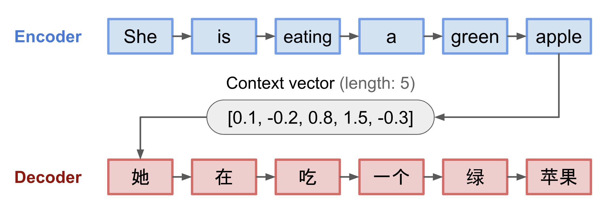
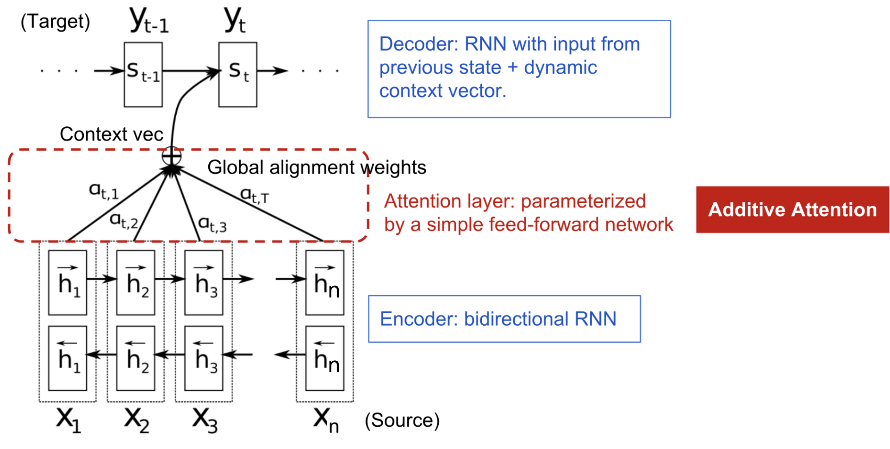
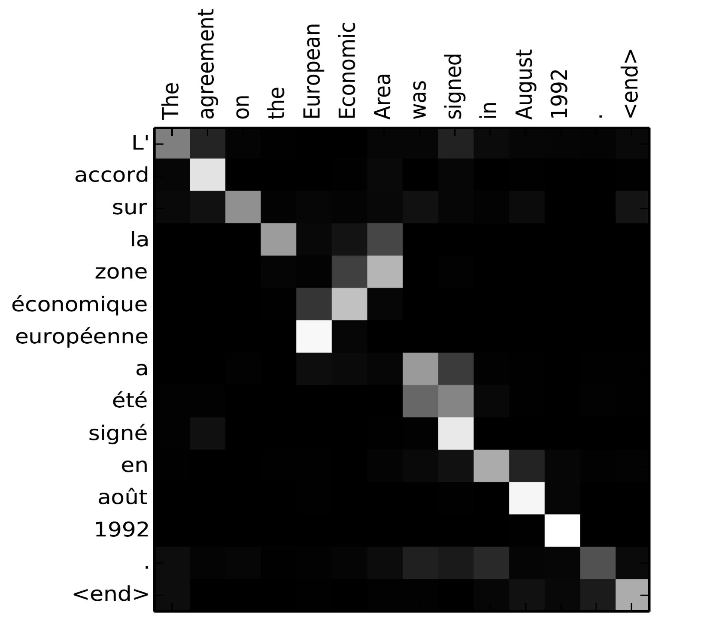

# Why attention

This page explains the problem attention was invented to solve, how the first attention mechanism worked, and why the obvious way to build self-attention fails. There is no heavy math here. That starts on the [next page](./02_self_attention.md).

## Context is the whole problem

To predict the next word, a model often needs information from far back in the text.

```text
I am from Pune, India. [ ... many sentences ... ] What language do I speak?
          ▲      ▲
          the answer depends on these, not on the words nearby
```

Looking only at the last few words is not enough. A language model needs **memory**: a way to carry information across a long sequence, and a way to pick out the part that matters right now.

## Before attention: the encoder-decoder RNN

A **recurrent neural network (RNN)** reads tokens one at a time and keeps a **hidden state**, a vector that summarises everything read so far. Each step combines the new token with the previous hidden state:

```text
h1 = f(x1, h0)
h2 = f(x2, h1)        h2 knows about x1 and x2
h3 = f(x3, h2)        h3 knows about x1, x2, and x3
```

For translation, two RNNs are chained:

- The **encoder** reads the source sentence (`I will eat`) and produces hidden states `h1, h2, h3`.
- The **decoder** receives **only the last hidden state** and generates the target sentence (`Je vais manger`) from it, one token at a time.

Think of a relay race. The baton passes from `h1` to `h2` to `h3`, and only that one baton is handed to the decoder.



*Image: [Lilian Weng, Attention? Attention!](https://lilianweng.github.io/posts/2018-06-24-attention/). The whole source sentence is squeezed into one fixed-length vector.*

**LSTMs** (1997) improved the memory by adding a second vector, the cell state, so information survives over longer distances. The architecture stays the same: one final state is handed to the decoder.

## The context bottleneck

Try this: read a long paragraph once, close your eyes, and translate it. You cannot. You remember a summary, but translation needs every word.

The decoder has the same problem:

- The final hidden state is one vector of perhaps 500 to 1,000 numbers.
- It must hold the entire source text, however long.
- The decoder never sees `h1` or `h2`, only the last state.

This is the **context bottleneck**. Quality drops sharply as sentences get longer, because early tokens get overwritten by later ones.

## The idea of attention

Humans do not translate from memory. They keep the source text in view and **look back at the relevant part** for each word they write.

**Bahdanau attention** (2014) gives the decoder the same ability:

1. Keep **all** encoder hidden states, not just the last.
2. At every decoding step, compute a weight for each encoder state: how relevant is it to the word being generated right now?
3. Build a fresh context vector for that step as the weighted sum of the encoder states.

$$
c_t = \sum_{i} \alpha_{t,i} h_i \qquad \text{with} \quad \sum_i \alpha_{t,i} = 1
$$

- `α_{t,i}` is the **attention weight**: how much decoding step `t` cares about source token `i`.
- For example, when generating the first French word, the weights might be 80% on `h1`, 10% on `h2`, 10% on `h3`.
- The weights are not hand-written. A small neural network computes them, and it is trained together with the rest of the model.



*Image: [Lilian Weng, Attention? Attention!](https://lilianweng.github.io/posts/2018-06-24-attention/), after Bahdanau et al., 2015.*

**Attention, in one sentence: selectively access parts of the input, with learned weights that say how much each part matters.**

### What the weights look like

The figure below is from the Bahdanau paper. Each row is a French word being generated, each column is an English source word, and a brighter cell means a larger attention weight.



*Image: Bahdanau et al., [Neural Machine Translation by Jointly Learning to Align and Translate](https://arxiv.org/abs/1409.0473), via [Lilian Weng](https://lilianweng.github.io/posts/2018-06-24-attention/).*

- Most bright cells sit on the diagonal: word `i` of the output mostly comes from word `i` of the input.
- `European Economic Area` becomes `zone économique européenne`. The word order is reversed, and the bright cells run **against** the diagonal. `européenne` is the 7th French word but attends to the 5th English word.

Translation is not word-by-word, and attention learned the reordering by itself. Nobody programmed it.

## From attention to the transformer

| Year | Architecture | What changed |
|---|---|---|
| 2014 | RNN + attention (Bahdanau) | Attention is added on top of the RNN encoder-decoder |
| 2017 | Transformer ([Attention Is All You Need](https://arxiv.org/abs/1706.03762)) | The RNN is removed. Attention alone, stacked in blocks, with an encoder and a decoder |
| 2018 | GPT | Only the decoder stack is kept, trained to predict the next token |

**Note:** "Attention Is All You Need" did not invent attention. It showed that attention is enough without recurrence. Removing the RNN also removed the one-token-at-a-time loop, so all positions can be processed in parallel. That is what made training on huge datasets practical.

## Self-attention

Bahdanau attention connects **two** sequences: the decoder (French) looks at the encoder (English).

An LLM has only one sequence, the text so far. So the tokens attend to each other:

> **Self-attention** lets every position in a sequence attend to all positions of the **same** sequence.

Why this helps next-token prediction:

```text
I am from Pune, India. I speak ___
          ▲      ▲         │
          └──────┴─────────┘   "speak" should pull in "Pune" and "India"
```

### Input embedding in, context vector out

| | Input embedding | Context vector |
|---|---|---|
| Made from | token embedding + positional embedding | the input embeddings of all visible tokens, mixed |
| Knows | what this token is and where it sits | that, plus how it relates to the other tokens |
| Example for `it` | "a pronoun, at position 11" | "a pronoun at position 11 that refers to the ball" |

The job of self-attention is to turn every input embedding into a context vector. Both have the same size. The context vector is simply a richer description.

### Queries and keys

Take the sentence `the next day is bright` and focus on `next`.

- The token doing the looking is the **query**: `next`.
- The tokens being looked at are the **keys**: `the`, `next`, `day`, `is`, `bright`. A token is also a key for itself.
- For each key we need an **attention weight** `α_{2j}`: how much of token `j` goes into token 2's context vector. The weights come from raw **attention scores**, one per key, normalised so they sum to 1.

```text
context(next) = α21·x(the) + α22·x(next) + α23·x(day) + α24·x(is) + α25·x(bright)
```

Everything now depends on one question: **how do we compute the score between a query and a key?**

## First attempt: dot product of the embeddings

The dot product of two vectors is large when they point in similar directions. So a natural first idea is:

```text
score21 = x(next) · x(the)
score22 = x(next) · x(next)
...
```

"Similar meaning, so high attention." It is simple, and it has no parameters.

### Why it fails

```text
The dog chased the ball but it could not catch it
                             ▲                  ▲
                         the dog            the ball
```

The two `it` tokens have the **same token embedding**. A raw dot product gives both of them almost the same scores against `dog` and `ball`, but the first refers to the dog and the second to the ball. Working that out needs the rest of the sentence: `chased`, `could not catch`.

The raw dot product has four built-in limits:

- **It measures similarity, not relevance.** `it` should attend to `ball`, but `it` and `ball` are not similar words. What matters is that one refers to the other.
- **It is symmetric.** `a · b = b · a`, so `it` would need `ball` exactly as much as `ball` needs `it`. Real relationships are one-directional.
- **Every token attends mostly to itself.** A vector is very similar to itself, so the diagonal tends to dominate.
- **Nothing can be learned.** The scores are fixed by the embeddings. There is no knob for training to turn.

## The fix: trainable projections

The standard deep-learning move: when you cannot write the rule by hand, put in a trainable matrix and let training find it. (It is the same reason a CNN learns its own image features.)

So before taking the dot product, project the two sides with **different** trainable matrices:

```text
query vector = x(it)   · W_Q        "what am I looking for?"
key vector   = x(ball) · W_K        "what do I offer?"

score = query vector · key vector
```

This removes every limit above:

- `W_Q` and `W_K` are different, so the score is **no longer symmetric**.
- The comparison happens in a new, learned space where "refers to" can score higher than "is similar to".
- Both matrices are trained by backpropagation, so the model learns what relevance means.

Trained models really do resolve the example. In GPT-2 small, when the final `it` is the query, one attention head (layer 5, head 4) puts **87%** of its weight on `ball`. Averaged over all 144 heads, `ball` gets 1.5× the weight of `dog`.

A third matrix, `W_V`, produces the **value** vectors: what each token actually contributes to the mix. The [next page](./02_self_attention.md) puts all three together.

### Where the names come from

**Note:** the lecture says the names relate to information theory. They come from **information retrieval** (databases and search):

In a database you send a **query**, it is matched against the **keys** of the stored records, and the matching record's **value** is returned. Attention does the same between tokens. [What query, key, and value signify](./02_self_attention.md#what-query-key-and-value-signify) spells out the three roles.
