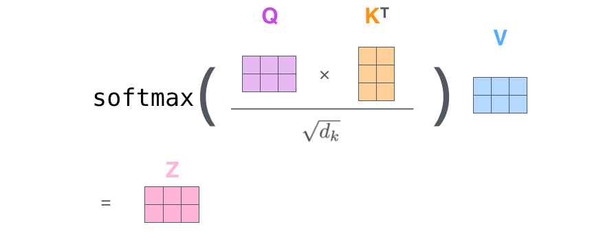
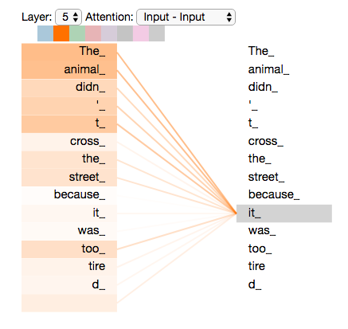

# Self-attention

Self-attention turns a matrix of input embeddings into a matrix of context vectors in four steps. This page walks through each step with real numbers, explains why the scores are divided by `√d_k`, and ends with the code.

$$
\text{Attention}(Q, K, V) = \text{softmax}\left(\frac{Q K^\top}{\sqrt{d_k}}\right) V
$$



*Image: [Jay Alammar, The Illustrated Transformer](https://jalammar.github.io/illustrated-transformer/) (CC BY-NC-SA 4.0).*

## Setup

- 5 tokens: `the`, `next`, `day`, `is`, `bright`
- `d_in = 8`: each input embedding has 8 numbers
- `d_out = 4`: each query, key, value, and context vector has 4 numbers

The input `X` is a `5 × 8` matrix, one row per token.

`d_out` is a free choice. It is 4 here only to show that it can differ from `d_in`. In real models the attention layer as a whole returns the same width it received (768 in, 768 out for GPT-2 small).

## The pipeline

```text
X (5×8)
  │  × W_Q, W_K, W_V  (each 8×4)          1. project
  ▼
Q (5×4)   K (5×4)   V (5×4)
  │  Q · Kᵀ
  ▼
scores (5×5)                              2. one score per (query, key) pair
  │  ÷ √d_k, then softmax per row
  ▼
weights (5×5)                             3. each row sums to 1
  │  · V
  ▼
Z (5×4)                                   4. context vectors
```

### 1. Queries, keys, values

Three trainable matrices, each of shape `d_in × d_out` (`8 × 4`):

```text
Q = X · W_Q        (5×8) · (8×4) = (5×4)
K = X · W_K        (5×8) · (8×4) = (5×4)
V = X · W_V        (5×8) · (8×4) = (5×4)
```

- Row `i` of each result belongs to token `i`.
- So every token now has three vectors, one per role: its **query** (used when it is looking), its **key** (used when it is being looked at), and its **value** (what it contributes).
- The matrices start random and are trained by backpropagation along with the rest of the model.
- From here on, `X` is not used again. Everything happens with `Q`, `K`, `V`.

#### What query, key, and value signify

The three vectors are three views of the same token, and together they work like a search engine:

| | The question it answers | Searching for a video |
|---|---|---|
| **Query** | "What am I looking for?" | the text you type in the search bar |
| **Key** | "What can I offer?" | the title and tags attached to every video |
| **Value** | "What information do I actually carry?" | the video itself, which you get once a match is found |

- The **query** belongs to the token that is seeking context. It is a search request sent to every token in the sequence.
- The **key** is a label attached to each token. The query is compared against every key to find out which tokens are relevant.
- The **value** is the content. Once query and keys have decided how much attention each token gets, the values are what is actually pulled in and combined.

In a sentence:

```text
The animal didn't cross the street because it was too tired
```

1. Processing `it`, the model builds a query that amounts to "who or what do I refer to?".
2. Every token offers its key. The key of `animal` matches the query well and gets a high score. The key of `street` matches poorly and gets a low one.
3. The scores decide the mix: mostly the **value** of `animal` is pulled into the new representation of `it`.

The [picture further down](#what-trained-attention-looks-like) shows exactly this in a trained model.

A search engine returns the best match. Attention is a **soft** lookup: every key matches to some degree, and the result is a blend of all the values, weighted by how well each key matched.

### 2. Attention scores

```text
scores = Q · Kᵀ        (5×4) · (4×5) = (5×5)
```

`K` is transposed so the shapes line up. Entry `[i, j]` is the dot product of query `i` with key `j`.

This dot product `q · k` is the **attention score**. Other names for the same thing: **alignment score** (from the translation papers) and **attention logit** (because it is the raw input to a softmax). It measures how well a query and a key line up: the higher the score, the more relevant that key is to that query.

- **Row `i`** = token `i` is the query. The row holds its scores against every key.
- **Column `j`** = token `j` is the key.

For our example:

| query ↓ / key → | the | next | day | is | bright |
|---|---|---|---|---|---|
| **the** | −2.67 | 0.88 | −6.20 | −3.01 | −3.43 |
| **next** | 1.35 | −0.01 | 3.65 | −2.10 | 0.81 |
| **day** | −4.11 | 0.07 | −11.07 | −4.46 | −5.36 |
| **is** | 0.60 | −0.02 | 1.26 | −1.94 | 0.26 |
| **bright** | −5.72 | 3.66 | −11.29 | −2.99 | −6.19 |

Read row 2: when `next` is the query, its highest score is with `day` (3.65).

Two things to notice:

- **The matrix is not symmetric.** `next → day` is 3.65 but `day → next` is 0.07. That is the effect of using different matrices for queries and keys.
- **Scores are not weights yet.** They can be negative and a row does not sum to anything meaningful. We cannot say "`next` gives 40% of its attention to `day`".

### 3. Attention weights

We want each row to behave like a pie chart: every entry between 0 and 1, and the row summing to 1. Then row `i` reads as "token `i` spends this fraction of its attention on each token".

Two operations get us there:

```text
weights = softmax(scores / √d_k)        applied to each row separately
```

**Softmax** turns a row of numbers into positive numbers that sum to 1:

$$
\text{softmax}(x)_i = \frac{e^{x_i}}{\sum_j e^{x_j}}
$$

**Scaling** divides every score by `√d_k` first, where `d_k` is the dimension of a key vector. Here `d_k = 4`, so we divide by 2. The [next section](#why-divide-by-d_k) explains why.

Row `next`, step by step:

```text
scores        [ 1.35  −0.01   3.65  −2.10   0.81 ]
÷ 2           [ 0.68  −0.01   1.83  −1.05   0.41 ]
softmax       [ 0.18   0.09   0.56   0.03   0.14 ]      sums to 1
```

The full weight matrix:

| query ↓ / key → | the | next | day | is | bright |
|---|---|---|---|---|---|
| **the** | 0.12 | 0.69 | 0.02 | 0.10 | 0.08 |
| **next** | 0.18 | 0.09 | 0.56 | 0.03 | 0.14 |
| **day** | 0.10 | 0.77 | 0.00 | 0.08 | 0.05 |
| **is** | 0.24 | 0.17 | 0.33 | 0.07 | 0.20 |
| **bright** | 0.01 | 0.95 | 0.00 | 0.03 | 0.01 |

Now row 2 has a clear reading: `next` puts 56% of its attention on `day`, 18% on `the`, 14% on `bright`, and so on.

| | Attention scores | Attention weights |
|---|---|---|
| Computed as | `Q · Kᵀ` | `softmax(scores / √d_k)` |
| Range | any real number | 0 to 1 |
| Row sum | anything | exactly 1 |

### 4. Context vectors

The values come in only now.

```text
Z = weights · V        (5×5) · (5×4) = (5×4)
```

Row `i` of `Z` is the **weighted sum of all value vectors**, using row `i` of the weights:

```text
Z[next] = 0.18·V[the] + 0.09·V[next] + 0.56·V[day] + 0.03·V[is] + 0.14·V[bright]
```

With the actual numbers:

```text
          weight      value vector
the        0.18  ×  [ −0.10  −0.28   0.52   1.03 ]
next       0.09  ×  [  0.66   0.23  −1.81  −0.19 ]
day        0.56  ×  [ −0.63  −0.15   0.02   1.60 ]
is         0.03  ×  [  1.16   2.14  −2.84  −2.62 ]
bright     0.14  ×  [  0.14   1.11  −0.28   1.18 ]
                    ────────────────────────────────
Z[next]          =  [ −0.26   0.11  −0.19   1.15 ]
```

`Z[next]` is dominated by `day`'s value vector, because `day` got most of the weight. That is the whole mechanism: **each token's output is a blend of every token's value, in proportion to the attention weights.**

**Why a separate value vector?** The key decides *whether* a token gets attention. The value decides *what it hands over* once it does. Those are different jobs, so they get different projections.

## Why divide by √d_k

There are two ways to see it. They are the same argument from two sides.

### Softmax gets "peaky" on large inputs

Softmax exaggerates differences, and the larger the inputs, the more it exaggerates:

```text
x          = [ 0.1  −0.2   0.3  −0.2   0.5 ]     softmax → [ 0.19  0.14  0.24  0.14  0.29 ]
x × 8      = [ 0.8  −1.6   2.4  −1.6   4.0 ]     softmax → [ 0.03  0.00  0.16  0.00  0.80 ]
```

Same numbers, same order, only the scale changed. With large inputs, almost all the weight lands on one entry.

Our example shows it too. For the row `next`:

```text
without scaling    [ 0.08  0.02  0.84  0.00  0.05 ]      84% on one token
with scaling       [ 0.18  0.09  0.56  0.03  0.14 ]      attention is spread out
```

A peaky softmax is bad for training:

- The token attends to a single key and ignores the rest.
- When softmax is saturated, its gradients are close to zero, so the weights stop learning.

### The scores grow with the dimension

A dot product is a **sum** of `d_k` terms. The more terms you add up, the more the total swings.

Dice make this concrete:

| | Mean | Variance |
|---|---|---|
| One die | 3.5 | 2.9 |
| Sum of 100 dice | 350 | 292 |

Each die adds its own variance to the total. A dot product over `d_k` dimensions behaves the same way: if the components of the query and key are independent with mean 0 and variance 1, then

$$
\text{Var}(q \cdot k) = d_k
$$

Dividing by `√d_k` divides the variance by `d_k`, which brings it back to 1 whatever the dimension.

An experiment with 100,000 random query-key pairs confirms it:

| `d_k` | Variance of `q · k` | Variance of `q · k / √d_k` |
|---|---|---|
| 5 | 5.03 | 1.01 |
| 100 | 100.54 | 1.01 |

**Note:** the lecture says the variance scales with the *square root* of the dimension. As the table shows, the variance scales with the dimension itself. It is the **standard deviation** that scales with the square root, and that is why the divisor is `√d_k` and not `d_k`.

So scaling keeps the scores in the same range for every model size. Without it, a model with 128-dimensional keys would start training with a far peakier softmax than one with 4-dimensional keys.

## Properties worth knowing

- **Everything is computed at once.** There is no loop over tokens. The whole layer is a few matrix multiplications, which is exactly what GPUs are good at. An RNN has to go token by token.
- **Any two tokens are one step apart.** Token 1 and token 1,000 interact directly. In an RNN the information has to survive 999 hops.
- **Cost grows with the square of the length.** The score matrix is `n × n`. Doubling the context makes attention 4× more expensive. This is the price of the previous point.
- **It has no sense of order.** Shuffle the input rows and the output rows are shuffled the same way, with identical values. Nothing in the math knows which token came first. This is why position has to be injected separately, with [positional embeddings](../01_journey_of_token.md#step-3-positional-embedding).
- **Parameters:** three matrices of `d_in × d_out`. The softmax and the scaling have none.

## Code

```python
import torch
import torch.nn as nn


class SelfAttention(nn.Module):
    def __init__(self, d_in, d_out):
        super().__init__()
        self.W_query = nn.Linear(d_in, d_out, bias=False)
        self.W_key = nn.Linear(d_in, d_out, bias=False)
        self.W_value = nn.Linear(d_in, d_out, bias=False)

    def forward(self, x):                                   # x: (n, d_in)
        queries = self.W_query(x)                           # (n, d_out)
        keys = self.W_key(x)                                # (n, d_out)
        values = self.W_value(x)                            # (n, d_out)

        scores = queries @ keys.T                           # (n, n)
        weights = torch.softmax(scores / keys.shape[-1] ** 0.5, dim=-1)
        return weights @ values                             # (n, d_out)
```

```python
x = torch.randn(5, 8)               # 5 tokens, d_in = 8
attn = SelfAttention(d_in=8, d_out=4)
attn(x).shape                       # torch.Size([5, 4])
```

- **`nn.Linear(..., bias=False)`** is a plain matrix multiplication: `W_query(x)` computes `x · W_Q`. It is used instead of a raw `nn.Parameter` because `nn.Linear` comes with a sensible weight initialisation.
- **`dim=-1`** applies softmax along each row, so each query's weights sum to 1.
- **`keys.shape[-1]`** is `d_k`.

## What trained attention looks like

In a trained model the weights carry meaning. Below, one attention head of a trained transformer is processing the word `it`:



*Image: [Jay Alammar, The Illustrated Transformer](https://jalammar.github.io/illustrated-transformer/) (CC BY-NC-SA 4.0), made with the Tensor2Tensor notebook.*

The darkest lines from `it` go to `The animal`. The model has worked out what the pronoun refers to and folds that information into `it`'s context vector.

## What is still missing

This version of self-attention lets every token see every other token, including the ones **after** it. Look at row `the` in the weight table: it puts 69% of its attention on `next`, a token that comes later.

For a model whose job is to predict the next token, that is cheating. [Causal attention](./03_causal_attention.md) fixes it.
