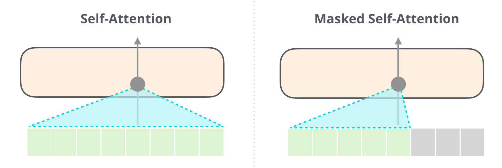
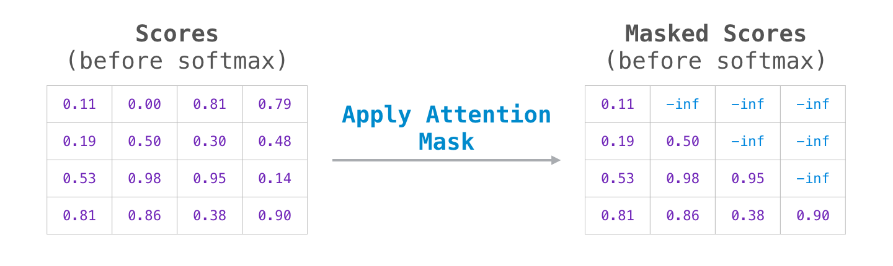
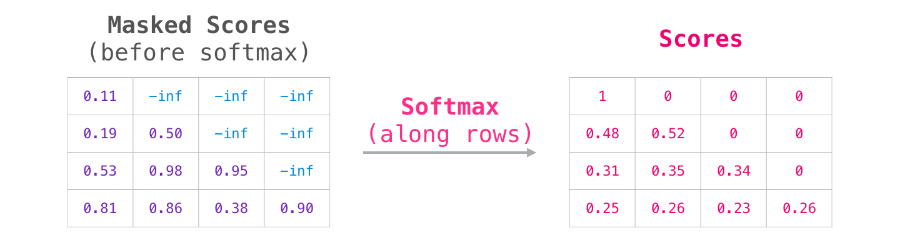

# Causal attention

[Self-attention](./02_self_attention.md) lets every token see the whole sequence. **Causal attention** adds one rule: a token may attend only to itself and the tokens **before** it.

It has many names for the same thing:

| This page's subject | The unrestricted version |
|---|---|
| causal attention | (plain) self-attention |
| masked attention | unmasked attention |
| unidirectional attention | bidirectional attention |
| autoregressive attention | |

"Causal" because only the tokens that came earlier can cause the next one.



*Image: [Jay Alammar, The Illustrated GPT-2](https://jalammar.github.io/illustrated-gpt2/) (CC BY-NC-SA 4.0).*

## Why the future must be hidden

### How training examples are built

An LLM is trained on plain text cut into chunks. Take a chunk of 4 tokens from the first page of *Harry Potter*:

```text
input     Mr    and   Mrs   Dursley
target    and   Mrs   Dursley   of          the input shifted by one token
```

That one row is not one training example. It is four:

| The model sees | It must predict |
|---|---|
| `Mr` | `and` |
| `Mr and` | `Mrs` |
| `Mr and Mrs` | `Dursley` |
| `Mr and Mrs Dursley` | `of` |

**For every prediction, the input is only the tokens that come before the answer.**

### The leak

All four predictions are computed in **one** forward pass, with all four tokens in the model at the same time. The output at position `t` is used to predict token `t + 1`.

With plain self-attention, position 2 (`and`) can attend to position 3 (`Mrs`). But `Mrs` is exactly what position 2 is supposed to predict. The answer is sitting in the input, and the model would learn to copy it.

- **Training would be useless.** The loss would drop to almost zero without the model learning anything about language.
- **Inference would not match.** When the model generates text, the future tokens do not exist yet. A model trained with access to them has learned a skill it can never use.

So the model must be built so that position `t` physically cannot receive information from positions after `t`.

## What gets masked

Look at the score matrix. Rows are queries, columns are keys:

```text
                 key →
query ↓      the   next   day    is   bright
the           ✓     ✗      ✗     ✗     ✗
next          ✓     ✓      ✗     ✗     ✗
day           ✓     ✓      ✓     ✗     ✗
is            ✓     ✓      ✓     ✓     ✗
bright        ✓     ✓      ✓     ✓     ✓
```

- Row `next` may use only `the` and `next`.
- The last row may use everything.
- **Everything above the diagonal is a look into the future and must end up with weight 0.**

There is one constraint: after masking, each row of weights must **still sum to 1**. There are two ways to get there.

## Strategy 1: mask the weights, then renormalise

Start from the finished attention weights of the [previous page](./02_self_attention.md#3-attention-weights), set the future entries to zero, and fix the row sums.

Row `is`:

```text
attention weights        [ 0.236  0.172  0.328  0.066  0.198 ]     sums to 1
zero the future          [ 0.236  0.172  0.328  0.066  0     ]     sums to 0.802
divide by the row sum    [ 0.294  0.215  0.409  0.082  0     ]     sums to 1
```

```text
scores → softmax → weights → zero above diagonal → divide by row sum → masked weights
```

It works, but it normalises twice: once in the softmax, once in the division.

## Strategy 2: mask the scores with −∞

Step in earlier. Replace the future **scores** with `−∞`, then run softmax once.





*Images: [Jay Alammar, The Illustrated GPT-2](https://jalammar.github.io/illustrated-gpt2/) (CC BY-NC-SA 4.0).*

Why it works: softmax computes `exp(x)` for each entry, and `exp(−∞) = 0`.

- A masked entry contributes 0 to the numerator, so its weight is exactly 0.
- It also contributes 0 to the denominator, so the remaining entries are normalised among themselves.

Row `is` again (scores already divided by `√d_k = 2`):

```text
scaled scores      [ 0.302  −0.009  0.632  −0.969   0.130 ]
mask               [ 0.302  −0.009  0.632  −0.969    −∞   ]
softmax            [ 0.294   0.215  0.409   0.082    0    ]
```

The result is identical to strategy 1, with a single normalisation:

```text
scores → −∞ above diagonal → softmax → masked weights
```

This is what every implementation does.

**Note:** it must be `−∞`, not 0. A score of 0 is a perfectly ordinary score: `exp(0) = 1`, so the token would still receive attention.

**Note:** the mask does not save computation. The full `n × n` score matrix is still calculated, and the future half is then thrown away. What the mask buys is correctness.

### The worked example

Masked scores:

| query ↓ / key → | the | next | day | is | bright |
|---|---|---|---|---|---|
| **the** | −2.67 | −∞ | −∞ | −∞ | −∞ |
| **next** | 1.35 | −0.01 | −∞ | −∞ | −∞ |
| **day** | −4.11 | 0.07 | −11.07 | −∞ | −∞ |
| **is** | 0.60 | −0.02 | 1.26 | −1.94 | −∞ |
| **bright** | −5.72 | 3.66 | −11.29 | −2.99 | −6.19 |

Causal attention weights, `softmax(masked scores / √d_k)`:

| query ↓ / key → | the | next | day | is | bright |
|---|---|---|---|---|---|
| **the** | 1.00 | 0 | 0 | 0 | 0 |
| **next** | 0.66 | 0.34 | 0 | 0 | 0 |
| **day** | 0.11 | 0.89 | 0.00 | 0 | 0 |
| **is** | 0.29 | 0.22 | 0.41 | 0.08 | 0 |
| **bright** | 0.01 | 0.95 | 0.00 | 0.03 | 0.01 |

Compare with the unmasked weights on the previous page:

- **Row 1 is always `[1, 0, 0, ...]`.** The first token has nobody else to look at, so its context vector is just its own value vector.
- **Row `next` changed completely.** It used to put 56% on `day`. Now `day` is hidden, and the attention is shared between `the` and `next`.
- **The last row did not change.** The last token is allowed to see everything.

The context vectors are computed exactly as before: `Z = weights · V`.

### Checking that nothing leaks

A direct test: replace the last token's input embedding with different numbers and see which outputs move.

| | Outputs of tokens 1 to 4 |
|---|---|
| Plain self-attention | **change** (they were reading token 5) |
| Causal attention | **identical** |

With the mask, a token's output depends only on itself and what came before.

## Dropout on the attention weights

**Dropout** randomly sets a fraction `p` of values to zero during training. Here it is applied to the attention weights, after the softmax.

- **Why:** it stops a token from relying on one particular connection. In each training step some connections are missing, so the model has to spread what it learns. This reduces overfitting.
- **Analogy:** a group project where two people do all the work. If those two are randomly absent, the others have to learn the material.
- **A new random pattern every forward pass.** Only the rate `p` is fixed.
- **Only during training.** At inference (`model.eval()`) dropout does nothing.

### The survivors are scaled up

PyTorch multiplies every surviving value by `1 / (1 − p)`. With `p = 0.5` the survivors are doubled.

Reason: on average a fraction `p` of the total has been removed. Scaling the rest by `1 / (1 − p)` keeps the expected total the same, so the next layer sees the same magnitude in training and at inference.

**Note:** the lecture says a rate of 0.4 scales by `1/0.4`. The factor is `1 / (1 − p)`, so it is `1/0.6 ≈ 1.67`.

Our causal weights after `nn.Dropout(0.5)`, one random draw:

| query ↓ / key → | the | next | day | is | bright |
|---|---|---|---|---|---|
| **the** | 2.00 | 0 | 0 | 0 | 0 |
| **next** | 0 | 0 | 0 | 0 | 0 |
| **day** | 0 | 1.77 | 0.01 | 0 | 0 |
| **is** | 0.59 | 0 | 0.82 | 0 | 0 |
| **bright** | 0.02 | 0 | 0 | 0.07 | 0 |

- Rows no longer sum to 1. That is expected during training.
- Dropout is per element, not per row. "50%" holds on average only. Here row `next` lost everything, and row `the` lost nothing.

GPT-2 used `p = 0.1`. Most modern LLMs train with no dropout at all.

## Code

Two changes from the `SelfAttention` class: the mask and the dropout. The input also gains a batch dimension.

```python
import torch
import torch.nn as nn


class CausalAttention(nn.Module):
    def __init__(self, d_in, d_out, context_length, dropout=0.0):
        super().__init__()
        self.W_query = nn.Linear(d_in, d_out, bias=False)
        self.W_key = nn.Linear(d_in, d_out, bias=False)
        self.W_value = nn.Linear(d_in, d_out, bias=False)
        self.dropout = nn.Dropout(dropout)
        # True above the diagonal = "this is a future token, hide it"
        mask = torch.triu(torch.ones(context_length, context_length), diagonal=1).bool()
        self.register_buffer("mask", mask)

    def forward(self, x):                                   # x: (b, n, d_in)
        b, n, d_in = x.shape
        queries = self.W_query(x)                           # (b, n, d_out)
        keys = self.W_key(x)
        values = self.W_value(x)

        scores = queries @ keys.transpose(1, 2)             # (b, n, n)
        scores = scores.masked_fill(self.mask[:n, :n], float("-inf"))
        weights = torch.softmax(scores / keys.shape[-1] ** 0.5, dim=-1)
        weights = self.dropout(weights)
        return weights @ values                             # (b, n, d_out)
```

```python
batch = torch.randn(2, 6, 3)        # 2 sequences, 6 tokens, d_in = 3
attn = CausalAttention(d_in=3, d_out=2, context_length=6)
attn(batch).shape                   # torch.Size([2, 6, 2])
```

- **`torch.triu(..., diagonal=1)`** keeps the entries strictly above the diagonal: exactly the "future" positions.
- **`masked_fill`** writes `−∞` wherever the mask is `True`.
- **`self.mask[:n, :n]`**: the mask is built once for the longest allowed sequence (`context_length`) and cropped to the actual length `n`.
- **`register_buffer`** stores the mask as part of the module without making it a trainable parameter. It then moves to the GPU together with the model (`model.to(device)`), which avoids device-mismatch errors.
- **`keys.transpose(1, 2)`** replaces `keys.T`: with a batch dimension in front, only the last two dimensions should be swapped.
- **Order matters:** mask, then scale, then softmax, then dropout. The mask must come before the softmax.

## What the mask makes possible

- **Training on every position at once.** One sequence of `n` tokens gives `n` valid predictions in a single forward pass. That is a big part of why transformers train efficiently.
- **The [KV cache](../../01_llm_inference/02_kv_cache.md).** A token's keys and values depend only on earlier tokens, so they never change when new tokens are appended. During generation they can be computed once and reused. This is what splits inference into [prefill and decode](../../01_llm_inference/01_terminologies.md).
- **Not every transformer is causal.** Encoder models such as BERT use unmasked attention, because their job is to understand a complete text, not to generate one. Every GPT-style LLM is causal.

One attention pattern per layer is still limiting: a sentence has many relationships at once. [Multi-head attention](./04_multi_head_attention.md) runs several patterns in parallel.
