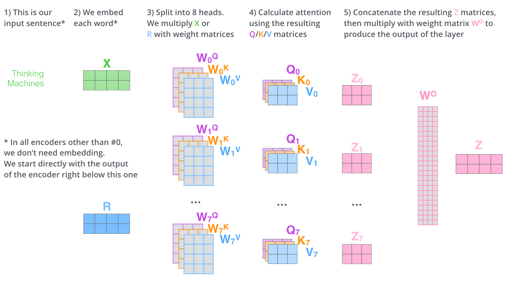
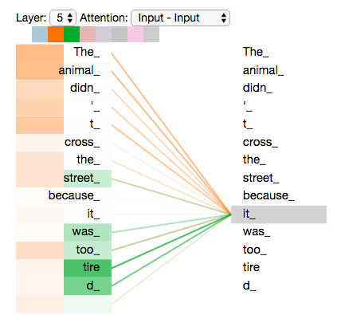

# Multi-head attention

One [causal attention](./03_causal_attention.md) layer produces **one** matrix of attention weights. **Multi-head attention** splits the vectors into several smaller pieces, runs attention on each piece separately, and joins the results. Each piece is a **head**, and each head gets its own attention pattern.

This page covers why that helps, how the split works, the tensor reshapes that implement it, and the final PyTorch class.

## Why one head is not enough

```text
The artist painted the portrait of a woman with a brush
```

This sentence has two readings:

| Reading | Who has the brush? | `brush` should attend to |
|---|---|---|
| 1 | The artist painted with a brush | `artist`, `painted` |
| 2 | The woman in the portrait holds a brush | `woman`, `portrait` |

Each reading needs a different set of attention weights. But a single attention layer has one weight matrix, and each row must sum to 1. Weight given to `artist` is weight taken away from `woman`.

More generally, a token takes part in many relationships at once: its grammatical role, what it refers to, which word it modifies, what is nearby. One softmax per token has to squeeze all of them into a single distribution.

**The idea:** run several attention computations side by side, each with its own softmax. One can track one relationship while another tracks something else.

The name: one attention computation is one "head" looking at the sentence. Several heads means several viewpoints.

**Note:** "each head captures one interpretation of the sentence" is a helpful intuition, not a guarantee. Nobody assigns jobs to heads. Training decides what each head does, and many heads end up doing things with no neat description.

## The idea in shapes

Keep `d_out` fixed and divide it among the heads:

```text
head_dim = d_out / num_heads
```

With `d_out = 4` and 2 heads, `head_dim = 2`. Each `8 × 4` weight matrix becomes two `8 × 2` matrices, one per head:

```text
W_Q (8×4)  →  W_Q1 (8×2), W_Q2 (8×2)          same for W_K and W_V
```

Each head then runs ordinary causal attention on its own slice. For `n` tokens:

| Step | One head | Two heads |
|---|---|---|
| Queries, keys, values | `n × 4` each | `n × 2` each, per head |
| Scores `Q · Kᵀ` | one `n × n` matrix | **two** `n × n` matrices |
| Weights | one `n × n` matrix | **two** `n × n` matrices |
| Context `weights · V` | `n × 4` | `n × 2` per head |
| Final output | `n × 4` | the two joined side by side: `n × 4` |

The key line is the scores: `(n × 2) · (2 × n)` is still `n × n`. Halving the vector width does **not** shrink the score matrix. So every head gets a full token-by-token attention pattern, and we now have two of them.



*Image: [Jay Alammar, The Illustrated Transformer](https://jalammar.github.io/illustrated-transformer/) (CC BY-NC-SA 4.0). This shows 8 heads, as in the original Transformer.*

## Worked example

Same setup as the previous pages: 5 tokens, `d_in = 8`, `d_out = 4`, and the same weights, now used as 2 heads of `head_dim = 2`.

- Head 1 uses columns 1 and 2 of `Q`, `K`, `V`.
- Head 2 uses columns 3 and 4.
- The scale factor is now `√head_dim = √2`, because that is the dimension of each key.

Head 1 attention weights:

| query ↓ / key → | the | next | day | is | bright |
|---|---|---|---|---|---|
| **the** | 1.00 | 0 | 0 | 0 | 0 |
| **next** | 0.61 | 0.39 | 0 | 0 | 0 |
| **day** | 0.13 | 0.83 | 0.04 | 0 | 0 |
| **is** | 0.25 | 0.19 | 0.26 | 0.30 | 0 |
| **bright** | 0.00 | **0.99** | 0.00 | 0.00 | 0.00 |

Head 2 attention weights:

| query ↓ / key → | the | next | day | is | bright |
|---|---|---|---|---|---|
| **the** | 1.00 | 0 | 0 | 0 | 0 |
| **next** | 0.63 | 0.37 | 0 | 0 | 0 |
| **day** | 0.25 | 0.74 | 0.01 | 0 | 0 |
| **is** | 0.28 | 0.24 | 0.44 | 0.04 | 0 |
| **bright** | 0.14 | 0.17 | 0.08 | **0.47** | 0.13 |

Look at the last row. For the query `bright`:

- Head 1 puts 99% on `next`.
- Head 2 puts most of its weight on `is` and spreads the rest.

Same token, same input, two different attention patterns. A single head gave only the first one (95% on `next`).

Each head multiplies its weights by its own values to get an `n × 2` context matrix. Joined side by side:

```text
              head 1            head 2
the      [ −0.10  −0.28  |   0.52   1.03 ]
next     [  0.20  −0.08  |  −0.35   0.58 ]
day      [  0.51   0.15  |  −1.21   0.13 ]
is       [  0.28   0.57  |  −0.39   0.85 ]
bright   [  0.66   0.24  |  −1.61  −0.83 ]
```

The output is `5 × 4`, the same shape single-head attention produced, but its two halves were built from two different views of the sentence.

### What the split really changes

Splitting the columns does not change `Q`, `K`, or `V` at all. They are the same numbers as before. In fact:

```text
single-head scores = head 1 scores + head 2 scores
```

A dot product over 4 dimensions is just the dot product over the first 2 plus the dot product over the last 2.

So the only real difference is **where the softmax is applied**:

| | What happens |
|---|---|
| Single head | add the partial scores together, then **one** softmax |
| Multi-head | a **separate** softmax on each partial score |

Adding first lets a strong signal in one part drown out the other. Keeping them apart lets each part pick its own winners. That is the whole trick.

### The trade-off

- More heads means more attention patterns.
- But `head_dim = d_out / num_heads`, so each head works with smaller vectors and can represent less.

It is divide and conquer: narrower experts, more of them. In practice the trade pays off, and every LLM uses many heads.

Multi-head attention costs almost nothing extra: `W_Q`, `W_K`, and `W_V` have the same size as for a single head of width `d_out`, and the amount of computation is about the same. The only addition is the small output projection described below.

## The implementation: reshape, do not loop

Looping over heads would be slow. The standard implementation keeps one big `W_Q`, `W_K`, `W_V` and makes the heads appear by reshaping the tensors, so all heads run in one batched matrix multiplication.

Example sizes: batch `b = 1`, `n = 3` tokens, `d_in = d_out = 6`, `num_heads = 2`, so `head_dim = 3`.

| # | Step | Shape | Example |
|---|---|---|---|
| 1 | Input `x` | `(b, n, d_in)` | `(1, 3, 6)` |
| 2 | Project: `Q`, `K`, `V` | `(b, n, d_out)` | `(1, 3, 6)` |
| 3 | Split the last dimension: `view` | `(b, n, h, head_dim)` | `(1, 3, 2, 3)` |
| 4 | Group by head: `transpose(1, 2)` | `(b, h, n, head_dim)` | `(1, 2, 3, 3)` |
| 5 | Scores: `Q @ K.transpose(2, 3)` | `(b, h, n, n)` | `(1, 2, 3, 3)` |
| 6 | Mask, scale, softmax, dropout | `(b, h, n, n)` | `(1, 2, 3, 3)` |
| 7 | Context: `weights @ V` | `(b, h, n, head_dim)` | `(1, 2, 3, 3)` |
| 8 | Group by token: `transpose(1, 2)` | `(b, n, h, head_dim)` | `(1, 3, 2, 3)` |
| 9 | Merge the heads: `view` | `(b, n, d_out)` | `(1, 3, 6)` |
| 10 | Output projection | `(b, n, d_out)` | `(1, 3, 6)` |

The steps that need explaining:

### Step 3: split the last dimension

Each token's 6 numbers are cut into 2 groups of 3. Nothing is computed, the same numbers are just given one more index.

```text
before  (n, d_out)                    after  (n, h, head_dim)

token 1  [ a b c d e f ]              token 1  [ a b c ]   head 1
                                               [ d e f ]   head 2
token 2  [ g h i j k l ]              token 2  [ g h i ]   head 1
                                               [ j k l ]   head 2
```

### Step 4: group by head

After step 3 the data is organised **token first**: each token holds its two head slices. But attention has to run **within a head, across tokens**. Swapping dimensions 1 and 2 puts the head first:

```text
before  (n, h, head_dim)              after  (h, n, head_dim)

token 1   head 1  [ a b c ]           head 1   token 1  [ a b c ]
          head 2  [ d e f ]                    token 2  [ g h i ]
token 2   head 1  [ g h i ]           head 2   token 1  [ d e f ]
          head 2  [ j k l ]                    token 2  [ j k l ]
```

Now each head is a normal `n × head_dim` matrix, which is exactly what the attention formula expects.

### Step 5: scores for all heads at once

`@` multiplies the **last two** dimensions and treats everything in front as a batch. So `b` and `h` are both just batch dimensions, and every head is computed in the same call.

```text
Q                        (b, h, n, head_dim)
K.transpose(2, 3)        (b, h, head_dim, n)       swap the last two dimensions
Q @ K.transpose(2, 3)    (b, h, n, n)              one n × n score matrix per head
```

### Step 6: mask, scale, softmax, dropout

Exactly as in [causal attention](./03_causal_attention.md), applied to every head. The scale is `√head_dim`. The `n × n` mask is applied to all batches and heads automatically (broadcasting).

### Steps 8 and 9: put the heads back together

The reverse of steps 3 and 4. First swap back to token-first, then flatten the last two dimensions, so each token's head outputs sit side by side again:

```text
token 1   head 1  [ p q r ]     →     token 1  [ p q r s t u ]
          head 2  [ s t u ]
```

`.contiguous()` is needed before the final `.view()`. `transpose` does not move any data, it only changes how the tensor is indexed. `view` requires the data to be laid out in memory in the new order, and `.contiguous()` makes that copy. (`.reshape()` does both in one call.)

### Step 10: output projection

One more linear layer, `d_out → d_out`.

After step 9 the heads sit in separate slices of the vector and have never interacted. The projection mixes them, so the next layer receives a blend of all heads instead of a set of isolated pieces.

**Note:** the lecture stops at step 9. The projection is part of the original Transformer (`W_O` in the image above) and of every GPT model (`c_proj` in GPT-2), so the code below includes it.

## Code

```python
import torch
import torch.nn as nn


class MultiHeadAttention(nn.Module):
    def __init__(self, d_in, d_out, context_length, num_heads, dropout=0.0):
        super().__init__()
        assert d_out % num_heads == 0, "d_out must be divisible by num_heads"
        self.num_heads = num_heads
        self.head_dim = d_out // num_heads

        self.W_query = nn.Linear(d_in, d_out, bias=False)
        self.W_key = nn.Linear(d_in, d_out, bias=False)
        self.W_value = nn.Linear(d_in, d_out, bias=False)
        self.out_proj = nn.Linear(d_out, d_out)             # mixes the heads
        self.dropout = nn.Dropout(dropout)
        mask = torch.triu(torch.ones(context_length, context_length), diagonal=1).bool()
        self.register_buffer("mask", mask)

    def forward(self, x):                                   # x: (b, n, d_in)
        b, n, d_in = x.shape

        # 2. project                                          (b, n, d_out)
        queries = self.W_query(x)
        keys = self.W_key(x)
        values = self.W_value(x)

        # 3. split the last dimension into heads              (b, n, h, head_dim)
        # 4. group by head                                    (b, h, n, head_dim)
        queries = queries.view(b, n, self.num_heads, self.head_dim).transpose(1, 2)
        keys = keys.view(b, n, self.num_heads, self.head_dim).transpose(1, 2)
        values = values.view(b, n, self.num_heads, self.head_dim).transpose(1, 2)

        # 5. scores per head                                  (b, h, n, n)
        scores = queries @ keys.transpose(2, 3)

        # 6. mask, scale, softmax, dropout                    (b, h, n, n)
        scores = scores.masked_fill(self.mask[:n, :n], float("-inf"))
        weights = torch.softmax(scores / self.head_dim ** 0.5, dim=-1)
        weights = self.dropout(weights)

        # 7. context per head                                 (b, h, n, head_dim)
        context = weights @ values

        # 8, 9. group by token, merge the heads               (b, n, d_out)
        context = context.transpose(1, 2).contiguous().view(b, n, self.num_heads * self.head_dim)

        # 10. output projection                               (b, n, d_out)
        return self.out_proj(context)
```

The comments use the step numbers of the table above.

```python
batch = torch.randn(2, 3, 6)        # 2 sequences, 3 tokens, d_in = 6
attn = MultiHeadAttention(d_in=6, d_out=6, context_length=3, num_heads=2)
attn(batch).shape                   # torch.Size([2, 3, 6])
```

Fed the weights of the worked example, the `context` tensor just before `out_proj` is exactly the merged matrix above.

About 30 lines, and this is the core of every GPT-style model. Production code usually replaces steps 5 to 7 with one call to `torch.nn.functional.scaled_dot_product_attention`, which does the same math with faster kernels (FlashAttention).

## Real models

| Model | `d_model` | Heads | `head_dim` |
|---|---|---|---|
| Original Transformer | 512 | 8 | 64 |
| GPT-2 small | 768 | 12 | 64 |
| GPT-2 medium | 1,024 | 16 | 64 |
| GPT-2 large | 1,280 | 20 | 64 |
| GPT-2 XL | 1,600 | 25 | 64 |
| GPT-3 (davinci) | 12,288 | 96 | 128 |

- `d_in = d_out = d_model`: the attention layer returns the width it received, so blocks can be stacked and the [skip connection](../01_journey_of_token.md#skip-connections) can add input to output.
- Models grow by adding heads, not by widening them. `head_dim` stays near 64 to 128.
- GPT-2 small has 12 layers × 12 heads = **144 attention patterns** for every token.
- One GPT-2 small attention layer has 2,362,368 parameters: `768 × 2304 + 2304` for the query, key, and value projections (stored as one matrix, with biases) and `768 × 768 + 768` for the output projection.

## What heads look like in trained models

The artist sentence, run through the real GPT-2 small. The query is the last token, `brush`:

| Head | Largest weights from `brush` | Looks like |
|---|---|---|
| Layer 6, head 11 | `painted` 0.47, `artist` 0.20 | reading 1: the brush belongs with the painting action |
| Layer 12, head 9 | `portrait` 0.37, `woman` 0.32 | reading 2: the brush belongs with the woman in the portrait |

Two heads in the same model, on the same sentence, attend to the two different readings. The lecture shows the same effect in BERT using [BertViz](https://github.com/jessevig/bertviz), a tool for browsing attention heads.

The same happens in other trained transformers. Below, two heads process the word `it`. One (orange) attends to `The animal`, the other (green) to `tired`:



*Image: [Jay Alammar, The Illustrated Transformer](https://jalammar.github.io/illustrated-transformer/) (CC BY-NC-SA 4.0).*

**Note:** read results like these with care.

- They are hand-picked. Most of the 144 heads show no pattern this clean.
- A large attention weight shows where a head looked, not what the model concluded.
- Studies that remove heads one at a time find that many can be deleted with little loss ([Michel et al., 2019](https://arxiv.org/abs/1905.10650); [Voita et al., 2019](https://arxiv.org/abs/1905.09418)). Some heads matter a lot, and many are redundant.

## What comes next

Multi-head attention is the attention used in every GPT model. Its cost shows up at inference: generating each new token needs the keys and values of all earlier tokens, in every head of every layer.

- The [**KV cache**](../../01_llm_inference/02_kv_cache.md) stores them so they are computed only once. It trades memory for speed, and that memory becomes the bottleneck for long contexts.
- **Multi-head latent attention (MLA)**, DeepSeek's change to this layer, compresses what is cached so the KV cache takes far less memory.
