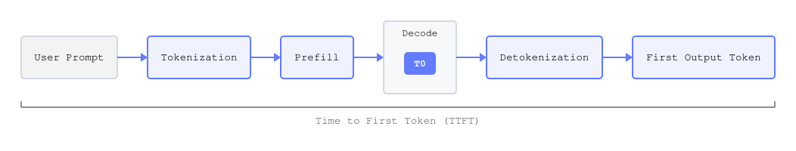

# Terminologies

An LLM request runs in two phases: **prefill** reads the prompt, **decode** writes the answer.



*Image: [Modular LLM Inference Handbook](https://handbook.modular.com/llm-inference-basics/how-does-llm-inference-work/) (Apache-2.0).*

## Prefill

The single forward pass over the whole prompt.

- **Input:** all `n` prompt tokens at once.
- **Work:** every token is processed in parallel, so it is one big batch of matrix multiplies. Attention cost grows as `O(n²)`.
- **Output:**
  - the [**KV cache**](./02_kv_cache.md): the attention keys and values of every prompt token, at every layer
  - the logits at the last position, from which the first output token is sampled
- **Bottleneck:** compute. The GPU is saturated, so prefill is fast per token but its total time grows with prompt length.
- **Decides:** [TTFT](#ttft).

Speed it up with a shorter prompt, or by reusing the KV cache of a shared prefix (prompt caching).

## Decode

The autoregressive loop that generates the output, one token per forward pass.

Each step:

1. Feed only the newest token.
2. Attend over the KV cache instead of recomputing the past.
3. Append this token's keys and values to the cache.
4. Sample the next token.

It stops on an end-of-sequence token or the `max_tokens` limit.

- **Cost per step:** roughly constant, growing slowly as the cache gets longer.
- **Bottleneck:** memory bandwidth. Each step reads all the weights and the whole KV cache to produce a single token, so the GPU's compute sits mostly idle.
- **Decides:** time per output token (TPOT), and so tokens per second.

Batching many requests into each step raises throughput a lot, because the weights are read once for the whole batch.

| | Prefill | Decode |
|---|---|---|
| Tokens per pass | all prompt tokens | 1 |
| Passes | 1 | one per output token |
| Bound by | compute | memory bandwidth |
| KV cache | builds it | reads and extends it |
| Metric | TTFT | TPOT |

## TTFT

**Time to first token:** from sending the request to receiving the first output token. It is what the user feels as responsiveness.

```text
TTFT ≈ network + queue wait + tokenization + prefill + first token
```

- Prefill usually dominates, so TTFT grows with prompt length.
- Under load, queue wait can dominate instead.
- Output length does not affect it.

End-to-end latency for `N` output tokens:

```text
latency ≈ TTFT + (N − 1) × TPOT
```
