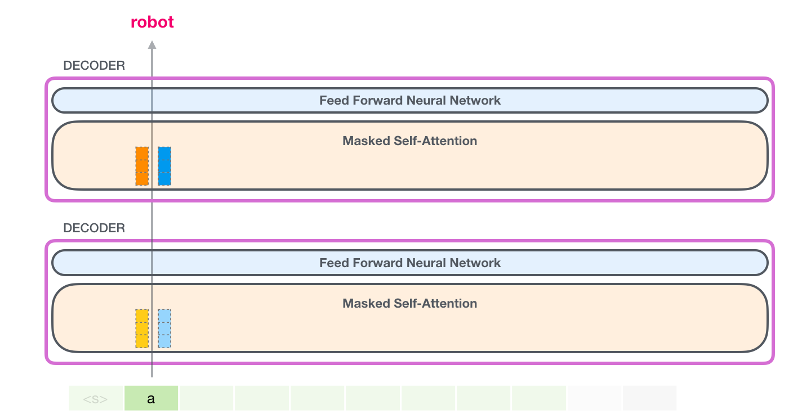
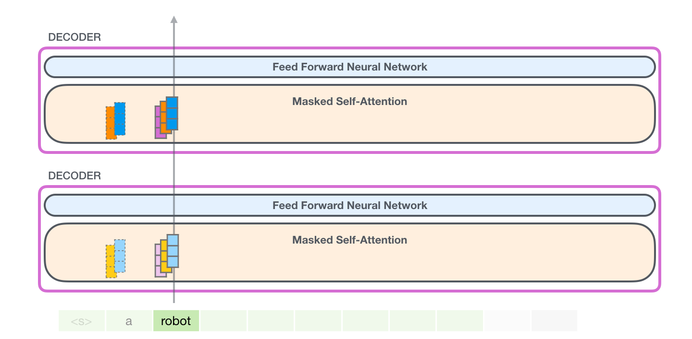
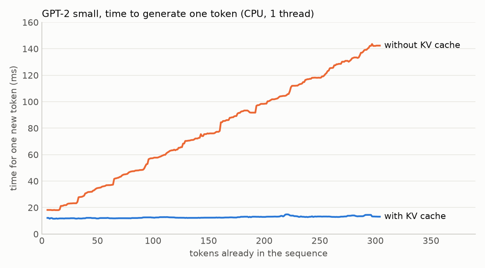

# KV cache

The **KV cache** (key-value cache) stores the attention keys and values of every token already processed, so that generating a new token does not recompute them.

- It exists **only at inference**. Training processes a whole sequence in one pass and has nothing to reuse.
- It changes **nothing about the output**. The model produces exactly the same tokens, only faster.
- It trades **memory for compute**, and that memory is its cost.

This page assumes [causal attention](../00_llm_core/attention/03_causal_attention.md) and [multi-head attention](../00_llm_core/attention/04_multi_head_attention.md). The worked example continues the one used there.

## The problem: generation repeats itself

An LLM [generates one token at a time](../00_llm_core/01_journey_of_token.md#the-generation-loop). Each new token is appended to the input, and the model runs again:

```text
pass 1    the next day is                  →  bright
pass 2    the next day is bright           →  and
pass 3    the next day is bright and       →  sunny
```

Without a cache, every pass pushes the **whole** sequence through every layer. `the next day is` is processed in pass 1, again in pass 2, and again in pass 3, and it gives the same intermediate results every time.

Two observations remove that waste.

## Observation 1: only the last position is used

A forward pass returns a logits matrix with one row per input token. Each row has one entry per vocabulary token (50,257 in GPT-2).

```text
input      the   next   day   is   bright
logits     row1  row2   row3  row4  row5
                                     ▲
                                     only this row picks the next token
```

- Row `t` is the prediction for the token after position `t`.
- During generation, the tokens after positions 1 to 4 are already known. Only **row 5** is needed.
- Row 5 is computed from the hidden state of the last token alone. So in every layer, the model only needs the **output for the last token**.

Inside attention, that output is the context vector of the last token. The other tokens are still needed, but only as things the last token attends to: as **keys and values**.

## Observation 2: the old keys and values never change

Take the example from the attention pages: 8-dimensional inputs, `d_out = 4`, one head. Run causal attention on 4 tokens, then on 5 tokens after `bright` is appended.

```text
                  4 tokens                 5 tokens
X                 (4, 8)                   (5, 8)
Q, K, V           (4, 4) each              (5, 4) each
scores            (4, 4)                   (5, 5)
weights           (4, 4)                   (5, 5)
context vectors   (4, 4)                   (5, 4)
```

Everything in the 4-token pass appears again, unchanged, inside the 5-token pass:

| Matrix | What is repeated | What is new |
|---|---|---|
| `Q`, `K`, `V` | the first 4 rows | the row for `bright` |
| scores, weights | the top-left 4×4 block | the last row (the last column is masked) |
| context vectors | the first 4 rows | the row for `bright` |

Why the old rows cannot change:

- `W_Q`, `W_K`, `W_V` are fixed after training. A token's query, key, and value depend only on that token's input vector.
- The **causal mask** stops old tokens from attending to the new one, so their weights and context vectors stay the same too.

Checked in code: all six comparisons (Q, K, V, scores, weights, context vectors) return `True` for the first 4 rows.

## The idea: work backwards from what is needed

We need one thing: the context vector of the new token, `bright`.

```text
context(bright)  =  weights(bright) · V            needs all 5 value vectors
weights(bright)  =  softmax(scores(bright) / √d_k)
scores(bright)   =  q(bright) · Kᵀ                 needs all 5 key vectors
```

So the step needs:

| Needed | Where it comes from |
|---|---|
| `q(bright)` | **compute:** `x(bright) · W_Q` |
| `k(bright)` | **compute:** `x(bright) · W_K` |
| `v(bright)` | **compute:** `x(bright) · W_V` |
| keys of the 4 earlier tokens | **cache** |
| values of the 4 earlier tokens | **cache** |
| queries of the earlier tokens | not needed at all |

- Only **keys** and **values** of old tokens are ever read again. That is where the name comes from.
- Old **queries** are useless: a query is only used to build that token's own row, and those rows are finished.
- The weight matrices are not "cached". They are the model's parameters and are always there.





*Images: [Jay Alammar, The Illustrated GPT-2](https://jalammar.github.io/illustrated-gpt2/) (CC BY-NC-SA 4.0). Top: `a` is processed and each layer keeps its key and value. Bottom: only `robot` is processed, and each layer reuses the saved vectors.*

## One decode step

Each attention layer does this when a new token arrives:

```text
x_new ──┬─ · W_Q ─→ q_new
        ├─ · W_K ─→ k_new ─→ append to K cache ─→ K     (n rows)
        └─ · W_V ─→ v_new ─→ append to V cache ─→ V     (n rows)

scores  = q_new · Kᵀ               (1, n)
weights = softmax(scores / √d_k)   (1, n)
context = weights · V              (1, d_out)
```

- **No mask is needed.** The new token is the last one, so every cached token is in its past. The single row has nothing to hide.
- The cache grows by one row per layer per step.

### With numbers

The 4-token pass left this in the cache:

```text
K cache                            V cache
the    [ −0.29  −2.31  −0.29  −0.51 ]   [ −0.10  −0.28   0.52   1.03 ]
next   [ −1.17   2.35   0.11  −0.41 ]   [  0.66   0.23  −1.81  −0.19 ]
day    [ −0.28  −4.57  −1.91  −0.68 ]   [ −0.63  −0.15   0.02   1.60 ]
is     [  0.24  −2.00  −3.56   2.43 ]   [  1.16   2.14  −2.84  −2.62 ]
```

Now `bright` arrives. Three small products, each a vector of 8 numbers times an 8×4 matrix:

```text
q(bright) = [  0.76   2.09   0.42   1.03 ]
k(bright) = [ −1.22  −2.16  −0.65  −0.46 ]      appended to the K cache as row 5
v(bright) = [  0.14   1.11  −0.28   1.18 ]      appended to the V cache as row 5
```

Then one row of attention:

```text
                 the     next    day      is     bright
scores        [ −5.72    3.66  −11.29   −2.99   −6.19 ]     q(bright) · Kᵀ
weights       [  0.01    0.95    0.00    0.03    0.01 ]     softmax(scores / 2)

context(bright) = weights · V = [ 0.67  0.30  −1.82  −0.25 ]
```

This is exactly the last row of the [causal attention example](../00_llm_core/attention/03_causal_attention.md#the-worked-example), which was computed from the full 5×5 matrix. Same result, a fraction of the work.

## In a full model

A real model has many layers and many heads. The idea is applied to each of them:

- **One cache per layer.** Layer `l` stores the keys and values made from its own input, which is the output of layer `l − 1`.
- **All heads are stored.** In GPT-2 small each layer holds keys and values of shape `(batch, 12 heads, n, 64)`.
- **Only the new token travels through the model.** Embedding, every block, the final norm, and the output layer all process a single position. The feed-forward networks, which hold most of the parameters, run once per token instead of once per token per pass.

```text
new token ─→ embedding (with its true position)
          ─→ block 1:  attention reads and extends cache 1  ─→ feed-forward
          ─→ block 2:  attention reads and extends cache 2  ─→ feed-forward
             ...
          ─→ final norm ─→ output layer ─→ one row of logits ─→ next token
```

**Note:** the lecture says that after the attention block "the other tokens do not matter". That is true inside one layer. Across layers there is one more step in the argument: layer 2's keys for the old tokens are built from layer 1's **outputs** for those tokens. They can be cached only because those outputs never change, and that is guaranteed by the causal mask in every layer. A bidirectional model such as BERT cannot use a KV cache: a new token would change the representation of every earlier token.

**Note:** the new token must be given its real position (position 5, not position 1) when it is fed in alone. Forgetting this is the classic bug in a hand-written cache.

### Prefill and decode

The cache is what splits a request into its [two phases](./01_terminologies.md):

| Phase | Input | Cache |
|---|---|---|
| **Prefill** | the whole prompt, in one parallel pass | built for every prompt token |
| **Decode** | one token per step | read, and extended by one row per layer |

## How much it saves

Count the work to generate `n` tokens, per layer:

| | Without cache | With cache |
|---|---|---|
| Tokens processed at step `t` | `t` | 1 |
| Tokens processed in total (projections, feed-forward) | `1 + 2 + … + n ≈ n²/2` | `n` |
| Query-key pairs scored at step `t` | `t²` | `t` |
| Query-key pairs scored in total | `≈ n³/3` | `≈ n²/2` |

**Note:** the lecture summarises this as "quadratic becomes linear". That is exact for the per-token work, which dominates in practice. The attention part goes from cubic to quadratic: a cached step still reads all `t` earlier keys and values, so a step is cheap but not free.

### Measured on GPT-2 small

Greedy generation from `The next day is bright`, on a laptop CPU with one thread. Both runs produce identical tokens.

| New tokens | With cache | Without cache | Speedup |
|---|---|---|---|
| 50 | 0.61 s | 1.28 s | 2.1× |
| 100 | 1.21 s | 3.61 s | 3.0× |
| 200 | 2.47 s | 11.58 s | 4.7× |
| 300 | 3.83 s | 23.83 s | 6.2× |



*Image: own measurement (GPT-2 small, Hugging Face `transformers`, CPU, 1 thread, best of 3 runs).*

- Without the cache, each step costs more than the one before.
- With the cache, a step costs about the same at 300 tokens (13.2 ms) as at 10 tokens (11.8 ms).
- The speedup is not a fixed number. It **grows with the sequence length**. The lecture measures about 3× for 100 tokens, which matches the table.

## The cost: memory

Everything cached has to stay in memory for as long as the request lives. The cache holds, for every layer, every head, and every token, one key and one value vector:

$$
\text{cache size} = 2 \times L \times B \times S \times N \times H \times \text{bytes per number}
$$

| Symbol | Meaning |
|---|---|
| 2 | one cache for keys, one for values |
| `L` | number of layers (transformer blocks) |
| `B` | batch size: sequences being generated at the same time |
| `S` | sequence length in tokens (at most the context length) |
| `N` | number of attention heads |
| `H` | dimension of one head, so `N × H` is the attention width |
| bytes per number | 2 for 16-bit floats, 4 for 32-bit floats |

The memory grows **linearly** with the sequence length, the batch size, the depth, and the width.

| Model | L | N × H | S | B | Precision | KV cache |
|---|---|---|---|---|---|---|
| GPT-2 small (measured) | 12 | 12 × 64 = 768 | 1,024 | 1 | 32-bit | 75 MB |
| Lecture example, "30B model" | 48 | 7,168 | 1,024 | 128 | 16-bit | 180 GB |
| DeepSeek-V3 dimensions, **if** it used plain multi-head attention | 61 | 128 × 128 = 16,384 | 100,000 | 1 | 16-bit | 400 GB |

- GPT-2 small stores 73,728 bytes per token. A full context is 75 MB, next to 498 MB of weights.
- The DeepSeek row is hypothetical. DeepSeek does not pay this, because [it does not cache full keys and values](#shrinking-the-cache).
- `S` is the number of tokens actually in the sequence. The context length only sets the worst case.

### Why the memory hurts

- **It limits how many users fit on a GPU.** Weights are shared by all requests. The cache is **per request**, so it is what runs out first when serving many long conversations.
- **It slows decode.** Every decode step reads the whole cache. Decode is limited by memory bandwidth, so a bigger cache means slower tokens.
- **It grows during the request.** The final size is not known up front, which makes memory planning hard. Serving systems such as vLLM allocate the cache in small blocks (PagedAttention) for this reason.

**Note:** the lecture explains GPT-4's pricing (the 32K-context model cost twice the 8K model per token) by the KV cache. A longer context does need more cache memory per request, so it is a plausible part of the reason, but OpenAI has not published how its prices are set.

**Note:** the lecture introduces caching as a way "to reduce the memory storage during inference". It is the opposite: caching removes computation and **adds** memory.

## Shrinking the cache

The memory problem has produced a family of fixes. All of them keep the cache and make it smaller.

| Technique | What it does | Cache per token, per layer |
|---|---|---|
| Multi-head attention (baseline) | every head has its own keys and values | `2 × N × H` |
| **Multi-query attention (MQA)** | all heads share one key head and one value head | `2 × H` |
| **Grouped-query attention (GQA)** | heads share keys and values in `g` groups | `2 × g × H` |
| **Multi-head latent attention (MLA)** | caches one small latent vector, and rebuilds keys and values from it | `d_c + d_R` |
| Quantising the cache | stores each number in fewer bits | same count, fewer bytes |

- MQA is the smallest but costs quality. GQA is the middle ground used by most open models (Llama, Mistral).
- MLA is DeepSeek's design. With DeepSeek-V3's sizes (`d_c = 512`, plus 64 dimensions for positions) it stores 576 numbers per token per layer, against 32,768 for plain multi-head attention. That is about 57× less: the hypothetical 400 GB above becomes about 7 GB.

Two related ideas reuse the cache instead of shrinking it:

- **Prompt caching:** requests that begin with the same prefix (a long system prompt, a document) reuse the cache of that prefix and skip its prefill.
- **Multi-turn chat:** the cache of the conversation so far is kept, so each new turn only prefills the new message.

Both work only for an identical **prefix**. Change one early token and every cached entry after it is invalid.

## Code

### A cached attention layer

The [`MultiHeadAttention`](../00_llm_core/attention/04_multi_head_attention.md) class with three changes: it accepts a cache, appends to it, and returns it.

```python
import torch
import torch.nn as nn


class CachedMultiHeadAttention(nn.Module):
    def __init__(self, d_in, d_out, context_length, num_heads):
        super().__init__()
        assert d_out % num_heads == 0, "d_out must be divisible by num_heads"
        self.num_heads = num_heads
        self.head_dim = d_out // num_heads
        self.W_query = nn.Linear(d_in, d_out, bias=False)
        self.W_key = nn.Linear(d_in, d_out, bias=False)
        self.W_value = nn.Linear(d_in, d_out, bias=False)
        self.out_proj = nn.Linear(d_out, d_out)
        mask = torch.triu(torch.ones(context_length, context_length), diagonal=1).bool()
        self.register_buffer("mask", mask)

    def split_heads(self, t):                               # (b, n, d_out) -> (b, heads, n, head_dim)
        b, n, _ = t.shape
        return t.view(b, n, self.num_heads, self.head_dim).transpose(1, 2)

    def forward(self, x, cache=None):                       # x: (b, n_new, d_in), only the NEW tokens
        b, n_new, _ = x.shape
        queries = self.split_heads(self.W_query(x))         # (b, heads, n_new, head_dim)
        keys = self.split_heads(self.W_key(x))
        values = self.split_heads(self.W_value(x))

        if cache is not None:                               # put the old keys and values in front
            keys = torch.cat([cache[0], keys], dim=2)       # (b, heads, n_total, head_dim)
            values = torch.cat([cache[1], values], dim=2)
        n_total = keys.shape[2]

        scores = queries @ keys.transpose(2, 3)             # (b, heads, n_new, n_total)
        mask = self.mask[n_total - n_new:n_total, :n_total] # the rows of the new tokens only
        scores = scores.masked_fill(mask, float("-inf"))
        weights = torch.softmax(scores / self.head_dim ** 0.5, dim=-1)

        context = (weights @ values).transpose(1, 2).contiguous().view(b, n_new, -1)
        return self.out_proj(context), (keys, values)       # the second item is the updated cache
```

- **`x` holds only the new tokens.** In prefill that is the whole prompt (`n_new = n_total`). In decode it is one token (`n_new = 1`).
- **`scores` is `n_new × n_total`**, not square: new queries against all keys.
- **The mask is cropped to the rows of the new tokens.** For a single new token that row is all `False`, so nothing is masked.
- Dropout is left out. It is only active in training, and the cache is only used at inference.

Check that it gives the same result as a full pass:

```python
torch.manual_seed(0)
attn = CachedMultiHeadAttention(d_in=8, d_out=4, context_length=16, num_heads=2)
x = torch.randn(1, 5, 8)                         # 5 tokens

full, _ = attn(x)                                # no cache: all 5 tokens at once

out, cache = attn(x[:, :4])                      # prefill: the first 4 tokens
last, cache = attn(x[:, 4:], cache)              # decode: only token 5

torch.allclose(full[:, 4:], last, atol=1e-6)     # True
cache[0].shape                                   # torch.Size([1, 2, 5, 2])  keys: (b, heads, n, head_dim)
```

### With Hugging Face

`transformers` returns the cache as `past_key_values`. The generation loop feeds only the newest token and passes the cache back in:

```python
import torch
from transformers import AutoModelForCausalLM, AutoTokenizer

tok = AutoTokenizer.from_pretrained("gpt2")
model = AutoModelForCausalLM.from_pretrained("gpt2").eval()

ids = tok("The next day is bright", return_tensors="pt").input_ids
past = None

with torch.no_grad():
    for _ in range(20):
        inp = ids if past is None else ids[:, -1:]              # prefill, then one token per step
        out = model(inp, past_key_values=past, use_cache=True)
        past = out.past_key_values                              # the updated KV cache
        next_id = out.logits[:, -1].argmax(dim=-1, keepdim=True)
        ids = torch.cat([ids, next_id], dim=1)

print(tok.decode(ids[0]))
# The next day is bright and sunny, and the sun is shining. The sun is shining, and the moon is shining.
```

`model.generate(...)` does the same internally. The cache is on by default, and `use_cache=False` turns it off, which is how the lecture compares the two.

## Summary

- Generation needs only the **last position's** output, and old tokens' **keys and values never change** thanks to the causal mask.
- So each layer saves keys and values, and a decode step computes one query, one key, and one value, then one row of attention.
- Old queries are never reused, which is why it is a **KV** cache.
- Compute per token becomes almost flat. The price is memory: `2 × L × B × S × N × H` numbers, per request.
- That memory is the main limit on long contexts and on how many requests a GPU can serve. MQA, GQA, and MLA all exist to shrink it.

Source: [Vizuara, Key Value Cache from Scratch](https://www.youtube.com/watch?v=IDwTiS4_bKo) (Build DeepSeek from Scratch series), plus own measurements.
